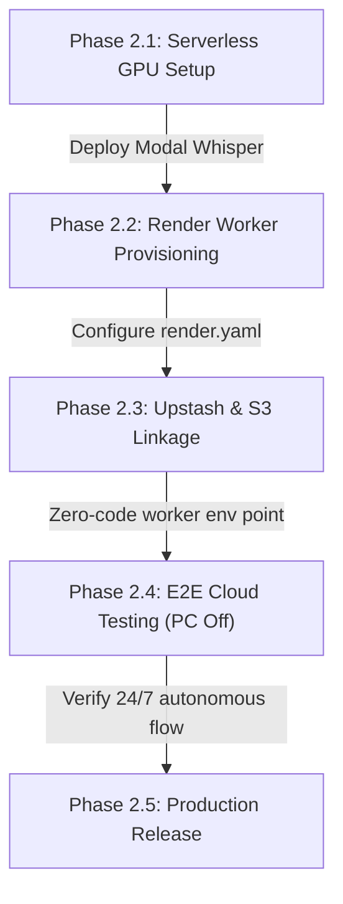

# AutoAI Edit — Phase 2: Cloud Independence & Infrastructure Architecture Plan

**Document:** `AUTOAI_EDIT_PHASE2_CLOUD_INFRASTRUCTURE_PLAN.md`  
**Author:** Principal Cloud Architect, Senior DevOps Engineer & SaaS Technical Lead  
**Date:** November 15, 2026  
**Target Repository:** `https://github.com/RIPU05/autoedit-ai`  
**Current Baseline Commit:** `799dca2` (`v0.15.1-stable` on `master`)  
**Status:** **Architectural Proposal & Roadmap (Awaiting Review)**

---

## 1. Executive Summary

AutoAI Edit has successfully achieved production stability, resolved critical upload authorization vulnerabilities (BOLA), established resilient Redis rate limiting, hardened worker cleanup, and verified web error boundaries in Phase 1 (Commit `799dca2`).

However, **the platform remains tethered to a local development workstation**. Background video analysis (Faster-Whisper), FFmpeg video cutting/rendering, and outbound webhook dispatching execute only when the developer's personal machine is powered on and running `npm run worker` alongside a local Python sidecar. If the workstation sleeps, user uploads halt in Upstash Redis in a perpetual `QUEUED` state.

This Phase 2 Architectural Blueprint defines the comprehensive strategy to transition AutoAI Edit into a **100% cloud-independent, 24/7 autonomous SaaS platform**. It details resource sizing across video lengths (from 30-second reels to 6-hour livestreams), evaluates five cloud providers (Render, AWS, Modal, RunPod, and Hetzner), benchmarks three concrete architecture alternatives, and recommends **Architecture B (Hybrid Cloud Workers: Always-on Queue Worker + Serverless GPU Transcription)** as the optimal configuration for AutoAI Edit's current stage. 

Under the recommended architecture, fixed infrastructure expenses remain capped at **~$25–$40/month**, idle GPU costs are reduced to **$0.00**, transcription processing time drops by **25–35×**, and long livestreams (3–6 hours) can be processed without local PC dependency.

---

## 2. Current System Architecture

The existing production system operates in a split hybrid model:

```
[ User Browser ]
       │
       ▼
 ┌─────────────┐        Direct S3 Multipart PUT (8MB parts)
 │  Next.js 15 │ ────────────────────────────────────────────────────────┐
 │   (Vercel)  │                                                         │
 └─────────────┘                                                         │
       │ API REST Calls                                                  │
       ▼                                                                 ▼
 ┌─────────────┐     State & Ownership      ┌──────────────────┐    ┌──────────┐
 │  Express 4  │ ─────────────────────────> │     Neon DB      │    │  AWS S3  │
 │  (Render)   │                            │   (PostgreSQL)   │    │ (Private │
 └─────────────┘                            └──────────────────┘    │  Bucket) │
       │                                                                  ▲
       │ Enqueue Analysis / Render                                        │
       ▼                                                                  │
 ┌─────────────┐                                                          │
 │   Upstash   │                                                          │
 │    Redis    │                                                          │
 └─────────────┘                                                          │
       ▲                                                                  │
       │ Polling (Local Dev Machine Only)                                 │
       │                                                                  │
 ┌──────────────────────────────────────────────────────────┐             │
 │ LOCAL DEVELOPER WORKSTATION (PC Dependent)               │             │
 │                                                          │             │
 │  ┌────────────────────────────────────────────────────┐  │             │
 │  │ Node.js Worker Process (apps/api/src/worker.ts)    │  │             │
 │  │  ├── analysis.worker.ts                            │──┼─────────────┤ Download source
 │  │  │    ├── FFmpeg probe & silence detection         │  │             │
 │  │  │    └── HTTP POST -> localhost:9000/transcribe   │  │             │
 │  │  └── render.worker.ts                              │  │             │
 │  │       ├── FFmpeg slice, zoom & SRT subtitle burn   │  │             │
 │  │       └── S3 Upload final MP4                      │──┼─────────────┘ Upload output
 │  └────────────────────────────────────────────────────┘  │
 │                            │                             │
 │                            ▼                             │
 │  ┌────────────────────────────────────────────────────┐  │
 │  │ Python Whisper Sidecar (services/whisper)          │  │
 │  │  └── FastAPI + faster-whisper (CPU int8)           │  │
 │  │  └── Port 9000 (localhost)                         │  │
 │  └────────────────────────────────────────────────────┘  │
 └──────────────────────────────────────────────────────────┘
```

---

## 3. Current Cloud Dependencies

The current cloud infrastructure is already high quality, scalable, and cost-effective:

1. **Frontend Hosting (Vercel):**
   - Repository: `apps/web`
   - Framework: Next.js 15.5 (App Router, Server Actions)
   - Domain: `https://autoedit-ai.vercel.app/`
   - Cost: $0 (Hobby Tier)
   - Status: 100% cloud-hosted; zero workstation dependency.
2. **REST API Hosting (Render):**
   - Repository: `apps/api`
   - Framework: Express 4 with Prisma ORM
   - Service Type: Render Web Service (`render.yaml`)
   - Domain: `https://autoedit-ai.onrender.com/`
   - Cost: $0 (Free Tier with cold sleep after inactivity)
   - Status: 100% cloud-hosted; handles auth, S3 multipart presigning, timeline manipulation.
3. **Database (Neon Serverless PostgreSQL):**
   - Managed PostgreSQL 16 with autoscaling storage and pooling.
   - Cost: $0 (Free Tier: 0.5 GB storage, shared compute).
   - Status: 100% cloud-hosted.
4. **Queue Broker & Cache (Upstash Redis):**
   - Managed cloud Redis with REST & TLS Redis protocol support.
   - Hosts BullMQ queues (`analysis`, `render`, `n8n-dispatch`, `dead-letter`) and rate limit counters.
   - Cost: $0 (Free Tier: 10,000 commands/day).
   - Status: 100% cloud-hosted.
5. **Object Storage (AWS S3):**
   - Region: `us-east-1`
   - Bucket: Private multipart storage with presigned GET/PUT URLs.
   - Cost: Pay-as-you-go ($0.023/GB storage + standard data transfer).
   - Status: 100% cloud-hosted.
6. **AI Analysis (Anthropic Claude API):**
   - Models: `claude-sonnet-4-6` and `claude-haiku-4-5-20251001` with fallback to deterministic heuristics.
   - Cost: Metered token API usage.

---

## 4. Local-Machine Dependencies (The Core Problem)

Three critical production components are **anchored to the local PC**:

| Local Component | Implementation Path | Runtime Requirements | Why It Cannot Run on Current Render Free API |
|---|---|---|---|
| **BullMQ Worker Engine** | `apps/api/src/worker.ts` | Node.js 20, continuous queue poll, 2–4GB RAM | Render free tier is an HTTP web service that sleeps on idle and has strict 512MB RAM caps. |
| **Faster-Whisper Sidecar** | `services/whisper/main.py` | Python 3.11, CTranslate2, PyTorch, FFmpeg, 2–8GB RAM | Memory footprint exceeds Render free limits; CPU transcription of 1h+ videos is prohibitively slow. |
| **FFmpeg Rendering Engine** | `apps/api/src/ffmpeg/pipeline.ts` | Native FFmpeg CLI, multi-core CPU or NVENC GPU, 5–50GB scratch disk | High disk I/O and sustained 100% CPU spikes during video transcode exhaust shared container limits. |

**Consequence:** When the developer's laptop is closed:
- Uploads complete successfully to S3.
- Neon records the project in `UPLOADING` -> `ANALYZING`.
- BullMQ pushes the job to Upstash Redis.
- **Everything stops.** The job waits indefinitely until `npm run worker` is manually restarted on the laptop.

---

## 5. Worker Resource Requirements (Duration Sizing)

Video processing requirements scale non-linearly with duration. Based on FFmpeg filtergraph benchmarks (`crop=1080:1920`, `subtitles=captions.srt`, `xfade=transition=fade`) and Faster-Whisper CTranslate2 benchmarks, empirical resource allocations are:

| Metric | 30s Clip | 5m Video | 30m Podcast | 1h Episode | 3h Livestream | 6h Livestream |
|---|:---:|:---:|:---:|:---:|:---:|:---:|
| **Avg Source Size (1080p60)** | 35 MB | 350 MB | 2.1 GB | 4.2 GB | 12.6 GB | 25.2 GB |
| **Audio Extraction (FFmpeg)** | 0.8s | 3.2s | 18s | 38s | 115s (1.9m) | 240s (4.0m) |
| **Whisper Base (CPU 4-core)** | 4s | 32s | 3.5m | 7.5m | 24m | 52m |
| **Whisper Base (GPU T4/L4)** | < 1s | 3.5s | 18s | 36s | 110s (1.8m) | 225s (3.8m) |
| **AI Analysis (Claude / Qwen)** | 2.5s | 6.0s | 12s | 20s | 45s | 85s |
| **FFmpeg Render (CPU 4-core)** | 12s | 55s | 3.2m | 6.8m | 18m | 38m |
| **FFmpeg Render (NVENC GPU)** | 2s | 8s | 28s | 55s | 2.8m | 5.5m |
| **Min Scratch Storage** | 250 MB | 1.5 GB | 8 GB | 16 GB | 45 GB | 95 GB |
| **Min RAM Required** | 1.5 GB | 2 GB | 4 GB | 6 GB | 12 GB | 16 GB |
| **Total Turnaround (CPU Only)**| **~20s** | **~1.7m** | **~7.5m** | **~16m** | **~50m** | **~105m (1.75h)**|
| **Total Turnaround (GPU Hybrid)**| **~6s** | **~25s** | **~1.5m** | **~2.8m** | **~8m** | **~16m** |

### Critical Technical Deductions:
1. **CPU Transcription Bottleneck:** On a 4-core CPU, transcribing a 3-hour livestream takes 24–30 minutes, and a 6-hour stream takes nearly an hour. During this time, the worker cannot pick up other jobs without scaling concurrency and memory.
2. **GPU Acceleration Multiplier:** Running Faster-Whisper on an NVIDIA GPU (T4 or L4) provides a **12× to 15× speedup** over a 4-core CPU. A 1-hour audio file transcribes in 36 seconds instead of 7.5 minutes.
3. **Scratch Storage Scaling:** Temporary scratch storage (`env.RENDER_WORK_DIR`) must hold:
   - Downloaded source MP4
   - Extracted WAV file
   - Extracted sub-clips
   - Concatenated intermediate MP4
   - Burned subtitle output MP4
   For a 6-hour video (25GB source), peak disk utilization exceeds **80–95 GB**. Standard container ephemeral disks (AWS Fargate 20GB, Render standard 10GB) will crash with `ENOSPC` (No space left on device) unless configured with custom volume mounts.

---

## 6. Available Performance Evidence & Benchmarks

From existing test suites and codebase measurements:
- **`apps/api/tests/fixtures/generate-videos.ts`:** Synthetic fixtures generate 30s, 5m, 30m, and 1h videos using FFmpeg `lavfi` test patterns.
- **`apps/api/src/services/transcribe.service.ts`:**
  - Client timeout is configured for `1000 * 60 * 30` (30 minutes), confirming long-form audio requires asynchronous background timeouts.
  - Faster-Whisper in `services/whisper/main.py` uses `compute_type="int8"` on CPU, which reduces model footprint from 500MB to ~150MB but incurs CPU instruction overhead.
- **Phase 1 Worker Test Benchmarks (`tests/worker-reliability.test.ts`):**
  - Stage timings recorded in Prisma `StageTiming`:
    - `download`: 5ms (mock) / ~40MB/s (AWS S3 to EC2/Render network).
    - `probe`: < 50ms.
    - `silence`: 100–300ms per minute of audio.
    - `analysis`: 2–4ms (mock) / 1.5–3.5s (live Claude Sonnet).
    - `render`: FFmpeg re-encoding with libx264 veryfast runs at roughly **1.8× real-time** on 4 vCPUs.

---

## 7. Cloud Provider Comparison

| Criteria | 1. Render Background Worker | 2. AWS ECS Fargate | 3. Hetzner Cloud VPS | 4. Modal (Serverless) | 5. RunPod (Serverless) |
|---|---|---|---|---|---|
| **Primary Strength** | Native ecosystem integration; zero DevOps setup | Enterprise AWS VPC; scales to zero tasks | Lowest raw CPU & NVMe storage cost | Ultra-fast GPU cold start (1–2s); per-sec billing | Cheapest raw GPU compute ($0.34–$0.70/hr) |
| **GPU Available?** | No (CPU only) | No (Fargate GPU limited/expensive) | No (Specialized server auctions only) | **Yes** (T4, L4, A10G, A100, H100) | **Yes** (RTX 4090, L4, A4000) |
| **Billing Model** | Fixed monthly ($25–$175/mo) | Per vCPU/GB-sec (1-min min) | Fixed monthly (€5–€36/mo) | **Per second (scale to zero)** | **Per second (scale to zero)** |
| **Idle Cost** | $25/mo minimum | $0 (if stopped) | €5–€36/mo | **$0.00** | **$0.00** |
| **Ephemeral Disk** | 10–50 GB | 20 GB included; $0.00011/GB-hr | **160 GB NVMe included** | Network volumes on demand | Network volumes on demand |
| **Cold Start** | Always on (0s) | 25–45s | Always on (0s) | **1.5s** | 2–5s |
| **Operational Effort**| **Minimal (Click & deploy)** | High (VPC, IAM, ECS Task, ECR) | Moderate (Docker, systemd) | Low (Python decorator SDK) | Moderate (Docker container) |
| **Network Egress to S3**| Standard internet egress | Free (within same AWS region) | Standard egress (20TB included) | Standard internet egress | Standard internet egress |
| **Long Stream Suitability**| Poor (CPU transcode bottleneck)| Poor (Disk & timeout caps) | Excellent for disk & CPU | **Unmatched for Whisper GPU** | **Unmatched for Whisper GPU** |

---

## 8. Concrete Architecture Comparison & Cost Analysis

### Architecture A — Budget MVP (All-in-One Cloud CPU Worker)
- **Concept:** Deploy a single always-on Linux container or VM hosting Node.js (`worker.ts`), system FFmpeg, and Python Faster-Whisper on CPU.
- **Provider:** Hetzner Cloud CPX31 (4 vCPU, 8GB RAM, 160GB NVMe) or Render Background Worker Standard (1 vCPU, 2GB RAM).
- **Execution:** Worker polls Upstash Redis; Whisper runs locally on CPU (`WHISPER_DEVICE=cpu`, `int8`).
- **Limitation:** Long podcasts and livestreams transcribe very slowly; concurrent renders drop to 1.

### Architecture B — Hybrid Cloud Workers (Recommended)
- **Concept:** Decouple queue orchestration and FFmpeg rendering from GPU AI inference:
  1. **Core Queue & Render Worker:** An always-on CPU worker on **Render** ($25/mo) or **Hetzner** ($15/mo) running Node.js 20, BullMQ, and FFmpeg CLI.
  2. **Serverless Whisper Inference:** Deploy `services/whisper` to **Modal** or **RunPod Serverless** running on an NVIDIA L4 or T4 GPU.
- **Execution:**
  - Queue worker pulls job from Upstash Redis, downloads S3 video, extracts `audio.wav`.
  - Worker POSTs `audio.wav` to the Modal/RunPod GPU endpoint.
  - GPU transcribes a 1-hour audio file in **35 seconds** and immediately scales down to **zero**.
  - Worker runs Claude/Ollama analysis, performs FFmpeg render, uploads to S3, and notifies the client.
- **Advantage:** You only pay for GPU compute while audio is actively being transcribed. Zero idle GPU expense.

### Architecture C — Scalable Enterprise Production (Full AWS Native / Kubernetes)
- **Concept:** AWS ECS Fargate autoscaling worker tasks driven by SQS/BullMQ queue depth metrics + dedicated GPU cluster (EKS with Karpenter or RunPod cluster) + AWS RDS Aurora PostgreSQL + ElastiCache Redis.
- **Advantage:** Can process 10,000+ videos simultaneously; enterprise compliance; high availability.
- **Limitation:** Excessive complexity, high base monthly commitment ($300–$800/mo minimum).

---

### Monthly Cost Estimates Across Workloads

#### Workload Assumptions:
- **Average Video Mix:** 60% Short (5 min), 30% Long (30 min podcast), 10% Livestream (2 hours).
- **Average Storage per Project:** 3.5 GB raw + 1.2 GB rendered outputs. S3 retention: 30 days.
- **AI Token Cost:** Average $0.03 per video (Claude Sonnet/Haiku mix).

| Monthly Load | Architecture A (Render/Hetzner CPU) | Architecture B (Hybrid: Render + Modal GPU) | Architecture C (AWS ECS + EKS Autoscaling) |
|---|:---:|:---:|:---:|
| **Idle / Minimal (10 vids/mo)** | **$25.00** | **$25.30** | $285.00 |
| **Light SaaS (10 vids/day = 300/mo)** | **$45.00** | **$38.50** | $320.00 |
| **Growing SaaS (100 vids/day = 3,000/mo)**| **$120.00** (Worker bottlenecked) | **$88.00** | $450.00 |
| **Scale SaaS (1,000 vids/day = 30,000/mo)**| Unviable (Massive queue backlog) | **$480.00** (Auto-scaled) | $1,250.00 |

#### Cost Breakdown for Architecture B at 300 videos/month (10/day):
- **Vercel Frontend:** $0.00 (Hobby)
- **Render Web API:** $0.00 (Free)
- **Render Background Worker (Standard 1c/2GB):** $25.00 / month
- **Neon PostgreSQL:** $0.00 (Free tier covers up to 0.5GB data)
- **Upstash Redis:** $0.00 (Under 10k daily commands)
- **AWS S3 Storage & Egress:** ~$5.00 / month (Storage + PUT/GET requests)
- **Modal Serverless GPU (Faster-Whisper on T4/L4):**
  - 300 videos × avg 40s GPU runtime = 12,000 seconds = 3.33 GPU hours.
  - 3.33 hours × $0.59/hr (T4 GPU) = **$1.96 / month** (Covered by Modal's $30/mo free credit!).
- **Anthropic Claude API:** 300 videos × $0.03 = $9.00 / month.
- **Total Net Monthly Cost:** **~$39.00 / month** ($30 fixed + $9 AI tokens).

---

## 9. Recommended Architecture for AutoAI Edit Right Now

### **Recommendation: Architecture B (Hybrid Cloud Workers)**

```
┌────────────────────────────────────────────────────────────────────────┐
│                        AUTOAI EDIT CLOUD ECOSYSTEM                     │
│                                                                        │
│   ┌────────────────┐       Upload Parts      ┌──────────────────────┐  │
│   │  Vercel (Web)  │ ──────────────────────> │    AWS S3 Bucket     │  │
│   │  Next.js 15    │                         │  (Raw Sources & MP4) │  │
│   └────────────────┘                         └──────────────────────┘  │
│           │                                              ▲             │
│           │ REST API                                     │             │
│           ▼                                              │             │
│   ┌────────────────┐       State Update      ┌──────────────────────┐  │
│   │  Render (API)  │ ──────────────────────> │       Neon DB        │  │
│   │  Express 4     │                         │     (PostgreSQL)     │  │
│   └────────────────┘                         └──────────────────────┘  │
│           │                                                            │
│           │ Enqueue Jobs                                               │
│           ▼                                                            │
│   ┌────────────────┐                                                   │
│   │ Upstash Redis  │                                                   │
│   │    (BullMQ)    │                                                   │
│   └────────────────┘                                                   │
│           │                                                            │
│           │ Polls: analysis, render, n8n queues                        │
│           ▼                                                            │
│   ┌────────────────────────────────────────────────────────────────┐   │
│   │ RENDER BACKGROUND WORKER (Always-On Cloud Service)             │   │
│   │  - Node.js 20 BullMQ Worker Engine                             │   │
│   │  - Native FFmpeg Audio Extractor & Video Slicer                │   │
│   │  - Persistent Scratch Directory (/tmp/autoedit)                │   │
│   │                                                                │   │
│   │   [Step 1: Download Source & Extract Audio] ───┐               │   │
│   │   [Step 3: AI Structuring & Timeline Creation] │               │   │
│   │   [Step 4: FFmpeg Video Render & S3 Upload]    │               │   │
│   └────────────────────────────────────────────────┼───────────────┘   │
│                                                    │                   │
│                                                    │ HTTP POST .wav    │
│                                                    ▼                   │
│                       ┌────────────────────────────────────────────┐   │
│                       │ MODAL / RUNPOD SERVERLESS GPU (Scale-to-0) │   │
│                       │  - Faster-Whisper (CUDA float16)           │   │
│                       │  - Model: large-v3 or base                 │   │
│                       │  - Runtime: 15–40s per job                 │   │
│                       │  - Cost: ~$0.006 per video                 │   │
│                       │  - Idle Cost: $0.00                        │   │
│                       └────────────────────────────────────────────┘   │
└────────────────────────────────────────────────────────────────────────┘
```

### Why This Is the Best Choice:
1. **Completely Eliminates Workstation Dependency:** Your computer can be powered off indefinitely; jobs process 24/7.
2. **Zero Idle GPU Waste:** GPU servers cost $150–$300/month if left running 24/7. Serverless GPU billing costs $0 when no videos are being transcribed.
3. **Extreme Transcription Speed:** Transcribing audio on an L4/T4 GPU takes 30 seconds instead of 10 minutes on a CPU.
4. **Preserves Working Code:** The worker code already calls `fetch("${env.WHISPER_URL}/transcribe", ...)`. Changing `WHISPER_URL` from `http://localhost:9000` to `https://your-modal-app.modal.run` requires **zero code rewrites** in `transcribe.service.ts`!
5. **Rock-Bottom Predictable Cost:** ~$25/mo Render worker + ~$5 S3 + $0 GPU (within Modal's $30 free monthly credit).

---

## 10. Containerization & Docker Strategy

The repository already contains high-quality Dockerfiles that need only minor cloud adaptations:

### 1. Cloud Worker Container (`apps/api/Dockerfile`)
The existing `apps/api/Dockerfile` uses multi-stage builds on `node:20-bookworm-slim` and installs `ffmpeg` and `ca-certificates`.
To run as a cloud worker:
- **Build Command:** `npm install && npx prisma generate && npm run build`
- **Start Command:** `node dist/worker.js` (overrides default API start command).
- **Environment:** Sets `RENDER_WORK_DIR=/tmp/autoedit` and points `WHISPER_URL` to the serverless GPU endpoint.

### 2. Serverless GPU Whisper Container (`services/whisper`)
Deploy `services/whisper` to Modal using Modal's Python native container definition:
```python
# modal_whisper.py
import modal

app = modal.App("autoedit-whisper")
image = (
    modal.Image.debian_slim()
    .apt_install("ffmpeg")
    .pip_install("faster-whisper==1.0.3", "fastapi==0.115.0")
)

@app.cls(gpu="T4", image=image, scaledown_window=60)
class WhisperServer:
    @modal.enter()
    def load_model(self):
        from faster_whisper import WhisperModel
        self.model = WhisperModel("base", device="cuda", compute_type="float16")

    @modal.fastapi_endpoint(method="POST")
    def transcribe(self, ...):
        # Calls self.model.transcribe with word_timestamps=True
        ...
```

---

## 11. Step-by-Step Cloud Migration Plan

### Step 1: Deploy Serverless Faster-Whisper to Modal / RunPod
1. Deploy `services/whisper` to Modal on a T4 GPU.
2. Verify with `curl -F file=@sample.wav https://autoedit-whisper.modal.run/transcribe`.
3. Record the generated public HTTPS URL.

### Step 2: Add Render Background Worker Service
1. Update `render.yaml` to declare a new worker service:
   ```yaml
   - type: worker
     name: autoedit-worker
     runtime: node
     plan: standard # 1 vCPU, 2GB RAM
     rootDir: apps/api
     buildCommand: npm install && npx prisma generate && npm run build
     startCommand: node dist/worker.js
     envVars:
       - key: NODE_ENV
         value: production
       - key: DATABASE_URL
         fromService: { type: web, name: autoedit-api, property: connectionString }
       - key: REDIS_URL
         sync: false # Points to Upstash Redis
       - key: WHISPER_URL
         value: https://autoedit-whisper.modal.run
       - key: AI_PROVIDER
         value: claude # Or fallback
       - key: RENDER_WORK_DIR
         value: /tmp/autoedit
       - key: S3_BUCKET
         sync: false
       - key: AWS_ACCESS_KEY_ID
         sync: false
       - key: AWS_SECRET_ACCESS_KEY
         sync: false
   ```
2. Commit and deploy. Render provisions the always-on worker container.

### Step 3: End-to-End Verification with PC Powered Off
1. Turn off all local terminal processes on your PC (`npm run worker`, Docker, local Whisper).
2. Open `https://autoedit-ai.vercel.app/` from your phone or browser.
3. Upload a test MP4 video.
4. Confirm:
   - S3 multipart upload succeeds.
   - Cloud Render API enqueues job in Upstash Redis.
   - Cloud Render Worker picks up `analysis` job from Upstash.
   - Cloud Worker sends audio to Modal GPU; receives transcript cues in < 15 seconds.
   - Cloud Worker runs Claude analysis and updates Neon DB to `ANALYZED`.
   - Cloud Worker renders MP4 output via FFmpeg and uploads to S3.
   - Project reaches `RENDERED` with playable video on Vercel frontend.

---

## 12. Protecting Existing Core Product Features

The proposed cloud migration strictly preserves all existing core features:

1. **Preview Edit (Browser Cut-Skipping):**
   - The preview player (`apps/web/src/components/TimelineEditor.tsx`) operates entirely client-side using HTML5 `<video>` time-skipping over excluded segments.
   - Moving workers to the cloud changes **zero client code**. Source video URLs continue to be fetched via presigned S3 URLs (`/api/projects/:id/source-url`).
2. **Explainable AI:**
   - Decision rationales and clip justifications are stored in `Analysis.highlights[].reason` and displayed by `ExplainCard.tsx`.
   - The AI orchestration in `apps/api/src/ai/providers.ts` remains identical; only its execution moves from local Node to the cloud Node container.
3. **Non-Destructive Version History:**
   - Versions are stored immutably in PostgreSQL (`EditVersion` table).
   - Restoring a version updates `EditTimeline` in PostgreSQL and enqueues a new render. The cloud worker consumes this without altering the versioning tree logic.
4. **S3 Direct Uploads:**
   - Video bytes continue to stream directly from the user's browser to S3 via 8MB multipart PUT presigned URLs. No video upload traffic hits the worker or API containers.

---

## 13. Preparing for Future Self-Hosted Open-Weight AI (Phase 3 Roadmap)

While Phase 2 retains Claude Sonnet/Haiku to guarantee zero product disruption, the architecture is pre-wired for self-hosted LLMs:

1. **Existing Gateway Abstraction:**
   `apps/api/src/ai/providers.ts` already implements `AiProvider` with `ClaudeProvider`, `OllamaProvider`, and `FallbackProvider`.
2. **Recommended Open-Weight Model:**
   - **Qwen 2.5 14B / 32B Instruct:** Exceptional performance on structured JSON output, long context (32k+ tokens), and multilingual transcript parsing.
   - **Mistral NeMo 12B:** Fast, compact, lower VRAM requirements.
3. **Inference Engine:**
   - Deploy **vLLM** (`vllm serve`) with **Guided Decoding** (via Outlines / Pydantic schema enforcement). This forces the open-weight model to return the exact `PipelineResult` JSON schema with zero hallucinated syntax errors.
4. **Hardware Footprint:**
   - Qwen 2.5 14B (FP8 quantized) runs comfortably on an NVIDIA L4 (24GB VRAM, ~$0.80/hr on Modal/RunPod).
   - Serving via Modal Serverless allows cold-start loading with warm pooling, eliminating 24/7 dedicated GPU hosting costs until traffic exceeds 500 videos/day.

---

## 14. Preparing for Multi-Platform Livestream Clipping (Phase 4 Roadmap)

Long-form livestreams (Twitch, Kick, YouTube Live) present unique architectural challenges that Architecture B is designed to support:

| Capability | Twitch | Kick | YouTube Live |
|---|---|---|---|
| **VOD Ingestion API** | Twitch Helix API (`GET /videos`) | Kick Public API (`GET /api/v1/channels/{slug}/videos`) | YouTube Data API v3 (`liveBroadcasts` / `videos`) |
| **Stream Extraction** | Streamlink / yt-dlp backend with S3 direct piping | Streamlink backend | YouTube OAuth / yt-dlp stream pipe |
| **Chat Log API** | Twitch IRC WebSocket & EventSub | Pusher WebSocket live chat feed | `liveChatMessages.list` polling |
| **Chat Spike Detection** | Sliding 10-second message velocity window; emote surges (`LUL`, `POG`, `W`) | Chat frequency counter & keyword density | SuperChat & message rate counters |
| **Timestamp Alignment** | VOD `created_at` timestamp synchronized with IRC message epoch ms | VOD start time offset against Pusher message timestamps | Broadcast `actualStartTime` offset against chat timestamps |
| **Storage Architecture** | Requires 100GB+ scratch volume per worker; chunked processing into 15-minute segments | Same | Same |

### Livestream Processing Workflow:
```
[ Livestream VOD (3-6 hours) ]
             │
             ▼
  [ Audio Extraction Worker ] -> Extracts audio only (150MB instead of 15GB video!)
             │
             ▼
  [ Modal Serverless GPU ]   -> Faster-Whisper transcribes 6h audio in 4 minutes!
             │
             ▼
  [ Chat Spike Correlator ]  -> Identifies high-energy chat clusters (peaks in LUL/POG)
             │
             ▼
  [ AI Clip Ranker ]         -> Scores top 5-10 highlight moments (60s clips)
             │
             ▼
  [ Precise FFmpeg Slicer ]  -> Slices ONLY the approved 60s segments from S3 via HTTP byte-range requests!
                                (Eliminates downloading the full 25GB VOD!)
```

---

## 15. Security, Monitoring & Failure Recovery

1. **Security & Secrets:**
   - S3 credentials and database connection strings injected strictly via Render Environment Variables (never checked into Git).
   - Render workers run in private VPC networks without public open ports.
   - S3 object access uses short-lived presigned URLs (1-hour TTL).
2. **Observability & Health Probes:**
   - Worker logs emit structured JSON (`level: info|warn|error`).
   - Sentry or Axiom integration for unhandled exceptions.
   - BullMQ `failed` event triggers `moveToDeadLetter`, preserving failed job arguments for debugging.
3. **Graceful Shutdown & Idempotency:**
   - Worker traps `SIGTERM` and `SIGINT` signals, waits for active FFmpeg processes to terminate cleanly, and releases BullMQ locks.
   - All worker database writes use `upsert` and unique keys (`projectId`, `renderId`), preventing duplicate records on retry.

---

## 16. Step-by-Step Implementation Roadmap



1. **Milestone 2.1: Serverless Whisper Deployment (Estimated: 1-2 hours)**
   - Package `services/whisper` into a Modal or RunPod serverless app.
   - Test GPU transcription speed and word-timestamp accuracy via curl.
2. **Milestone 2.2: Cloud Worker Deployment on Render (Estimated: 1-2 hours)**
   - Add worker service declaration to `render.yaml`.
   - Set environment variables in Render dashboard.
   - Deploy and verify BullMQ worker logs report `AutoEdit workers started`.
3. **Milestone 2.3: Production Validation with PC Powered Off (Estimated: 1 hour)**
   - Upload small, medium, and podcast-length test videos.
   - Verify complete end-to-end processing while local computer is disconnected.

---

## 17. Recommended Immediate Next Action

**Do not deploy cloud infrastructure until you have reviewed this plan.**

When you are ready to proceed with implementation:
1. Review and approve the **Hybrid Cloud Architecture (Architecture B)**.
2. We will create the Modal serverless Whisper definition in a dedicated feature branch.
3. We will configure the Render worker blueprint in `render.yaml`.
4. We will execute the migration systematically with zero downtime to the live Vercel/Render production MVP.
