# AUTOAI EDIT — COMPETITIVE ANALYSIS & RESEARCH REGISTER

**Document ID:** ARCH-017  
**Version:** 1.0.0-PROD  
**Target Repository:** `https://github.com/RIPU05/autoedit-ai`  
**Classification:** Product Strategy, Technology Benchmarking & Competitive Intelligence  
**Author:** Principal Software Architect, SaaS Product Architect & CTO  

---

## 1. Executive Summary

As AutoAI Edit expands its master architecture to support both **LITE** (low-cost, high-velocity signal clipping) and **PRO** (premium multimodal AI editing) processing tiers inside a single cloud application, this research register establishes a thorough competitive and technical benchmark against prevailing market solutions.

Historically, the livestream clipping and short-form video repurposing landscape has been split into two polarized extremes:
1. **Local Desktop Utilities (e.g., Stakeout Clips):** Inexpensive one-off scripts running locally on the creator's gaming machine that monitor chat activity, but consume heavy local CPU/GPU/disk resources and offer zero semantic AI intelligence.
2. **Heavyweight Cloud AI Repurposers (e.g., Opus Clip, Munch):** Cloud platforms designed primarily for pre-recorded podcasts and talking-head videos that incur significant GPU/LLM cloud costs per minute and lack real-time livestream ingestion, direct OBS protocols, and interactive timeline editing.

**AutoAI Edit bridges this divide** by introducing a 100% cloud-hosted, dual-tier architecture that offers zero-PC-burden clipping at both budget-conscious (LITE) and studio-grade AI (PRO) capabilities within one unified web workspace.

---

## 2. Competitive Landscape Benchmark

| Solution | Deployment Architecture | Hardware Requirement | Target Modality | Detection Mechanism | Transcription & Captions | Timeline Editing & History | Unit Economics to User |
| :--- | :--- | :--- | :--- | :--- | :--- | :--- | :--- |
| **Stakeout Clips** | Local Desktop App / Python CLI | Creator's Gaming PC (Windows) | Twitch / Kick Livestreams | Local Chat Velocity (IRC/WebSocket spikes) | None (Requires external local tools) | None (Static FFmpeg render cuts) | One-time Gumroad purchase (~$20–$50) |
| **StreamLadder** | Cloud Web SaaS | Any Browser / Cloud | Twitch / YouTube VODs | Manual clip selection / Basic clip imports | Basic static subtitles | Split-screen canvas reframing | Freemium ($9–$25/mo) |
| **Opus Clip** | Cloud SaaS | Any Browser / Cloud | Pre-recorded Video Uploads | AI Virality scoring on transcripts | High (Whisper GPU + Animated captions) | Cut-level trimming only | Credit-based (~$15–$29/mo) |
| **Munch** | Cloud SaaS | Any Browser / Cloud | Pre-recorded Video Uploads | GPT-4 keyword & trend extraction | High (Whisper + Social captioning) | Minimal post-processing | Subscription (~$49/mo) |
| **AutoAI Edit (LITE)** | **100% Cloud-Native SaaS** | **Zero Local PC (Any Web Browser)** | **Uploads + Twitch / Kick / YouTube + OBS** | **Deterministic Multi-Signal (Chat EWMA, Emotes, Silence)** | **Deterministic static or burnt subtitles** | **Full HTML5 Canvas Studio, Preview Edit, Version History** | **Generous Free / Low-Cost SaaS** |
| **AutoAI Edit (PRO)** | **100% Cloud-Native SaaS** | **Zero Local PC (Any Web Browser)** | **Uploads + Twitch / Kick / YouTube + OBS** | **Multimodal AI (Whisper GPU + Gemini/Claude Reasoning)** | **Word-Level Animated Karaoke + Multi-speaker** | **Full HTML5 Canvas Studio, Explainable AI, Refinement** | **Value-Driven Pro SaaS Subscription** |

---

## 3. Deep Architectural Analysis: Stakeout Clips vs. AutoAI Edit

### 3.1 Stakeout Clips Overview & Mechanism
*Source Reference: Public Stakeout Clips Gumroad Listing (`https://stakeoutclips.gumroad.com/l/qlhtf`)*

Stakeout Clips is a desktop-bound workflow utility built for Twitch and Kick streamers. Its technical operation comprises:
1. **Local IRC / WebSocket Listener:** Connects locally from the user's computer to Twitch IRC (`irc.chat.twitch.tv`) or Kick's Pusher WebSocket channels.
2. **Chat Velocity Spike Engine:** Tracks incoming messages per rolling 5–15 second window. When message count exceeds a user-defined threshold (e.g., 2.5x baseline velocity or specific emote triggers such as `KEKW`, `LUL`, `POG`), it flags a timestamp.
3. **Local Video Extraction:** Instructs the streamer's local OBS Studio (via OBS-WebSocket) to save an OBS Replay Buffer clip, or executes a local headless FFmpeg process against the platform's public HLS/DASH manifest to download a rolling segment.
4. **Local FFmpeg Encoding:** Transcodes the captured video segment using local NVENC or x264 into a 9:16 vertical crop and saves the MP4 directly to the user's local hard drive.

### 3.2 Fundamental Architectural Limitations of Stakeout Clips

```mermaid
flowchart TD
    subgraph LocalPCLimits["Stakeout Clips (Local Desktop Architecture)"]
        Game["Heavy 3D Game (Apex/Valorant)"] -->|Contends for GPU/RAM| PC["Streamer's Gaming PC"]
        OBS["OBS Studio Stream Encoder"] -->|Contends for CPU/NVENC| PC
        ChatBot["Local Chat Spike Daemon"] -->|Monitors IRC| PC
        FFmpegLocal["Local FFmpeg Video Render"] -->|Crashes / Drops Frames| PC
        PC -->|High Fan Noise, Lag| Disk["Local HDD/SSD Filled with Cuts"]
        Disk -->|Manual Transfer| Phone["Manual Phone Upload"]
    end

    subgraph AutoAICloud["AutoAI Edit (100% Cloud Architecture)"]
        Streamer["Streamer PC / Console / Mobile"] -->|Standard RTMP / OBS| CloudIngest["AutoAI Cloud MediaMTX Ingest"]
        CloudIngest --> RollingBuf["S3/R2 Ephemeral Rolling Buffer (30m)"]
        Platforms["Twitch / Kick / YouTube Chat"] -->|Cloud WebSockets| CloudBot["AutoAI Ingest Engine"]
        CloudBot --> SignalEngine["Cloud Signal Sieve (LITE or PRO)"]
        SignalEngine --> RenderWorker["Containerized Cloud Worker"]
        RenderWorker --> CloudStudio["AutoAI Cloud Web Studio"]
        CloudStudio -->|1-Click Direct Publish| Socials["TikTok / Shorts / Reels"]
    end

    style LocalPCLimits fill:#ffeeee,stroke:#cc0000,stroke-width:1px
    style AutoAICloud fill:#eeffee,stroke:#00aa00,stroke-width:1px
```



1. **Severe Local Hardware Resource Contention:**
   - Running modern games (e.g., *Call of Duty*, *Cyberpunk 2077*, *Apex Legends*) while simultaneously broadcasting via OBS encoding pushes local GPU VRAM, NVENC sessions, and CPU cores to their absolute ceiling.
   - Forcing a local FFmpeg render process to trigger concurrently during a high-action game moment (precisely when chat spikes occur) creates severe micro-stutter, dropped broadcast frames, or game crashes.
2. **Zero Semantic & Multimodal Context:**
   - Stakeout Clips has no capability to understand *what happened* in the stream. It cannot distinguish between a clutch gaming victory, a streamer sneezing, an off-topic raid, or a spam bot wave.
   - It cannot transcribe dialogue, identify punchlines, generate subtitle files, or evaluate comedic timing.
3. **Quiet-Chat Failure (Small to Mid-Tier Streamers):**
   - Streamers with fewer than 20–50 concurrent viewers rarely experience sudden 50-message chat surges. For these creators, Stakeout Clips yields zero clips during a 4-hour broadcast, rendering it ineffective.
4. **No Cloud Collaboration or Mobile Editing:**
   - Because clips reside as raw MP4 files on the streamer's local C:\ drive, video editors, social media managers, or mobile devices cannot access, review, or trim the footage without manual cloud uploading (Dropbox/Google Drive).
5. **No Non-Destructive Version History or Explainability:**
   - The output is a rigid, burned-in video file. If the 9:16 vertical crop cuts off the streamer's face or misses a critical HUD killfeed element, the clip must be manually re-edited from scratch in Premiere Pro or DaVinci Resolve.

---

## 4. Architectural Analysis: Cloud AI Repurposers (Opus Clip, Munch)

### 4.1 Overview & Strengths
Cloud repurposers like Opus Clip and Munch excel at converting static, pre-recorded, high-fidelity MP4 uploads (podcasts, conference talks, webinars) into vertical reels:
- High-accuracy Whisper transcription.
- LLM-based narrative coherence scoring.
- Face tracking using computer vision to center speakers in 9:16 vertical aspect ratios.

### 4.2 Limitations for Live Streaming & Creative Freedom
1. **Prohibitive Compute Economics:**
   - These platforms run 100% of uploaded footage through GPU Whisper and multi-stage LLM chains.
   - Applying this pipeline to 4-to-8-hour continuous livestreams results in unsustainable cloud costs ($5.00–$15.00+ per stream), forcing aggressive monthly credit caps (e.g., 60–120 minutes of processed video per month).
2. **Absence of Real-Time Livestream Ingest:**
   - None of these platforms support direct OBS streaming, RTMP ingestion, or real-time rolling buffers. Streamers must wait for broadcasts to conclude, download massive 20GB VODs, and re-upload them to the SaaS.
3. **Rigid Black-Box Rendering:**
   - Users are presented with final rendered shorts. If a caption timing is slightly off or a visual element is clipped, editing options are severely constrained to rudimentary web text overlays without timeline access or non-destructive layers.

---

## 5. AutoAI Edit Competitive Moat & Strategic Positioning

AutoAI Edit synthesizes the zero-latency, high-velocity signal detection of streaming utilities with the cloud accessibility and deep intelligence of studio-grade AI:

### 5.1 Pillar 1 — 100% Zero-PC Cloud Infrastructure
- **No Local Software Required:** Operates entirely in cloud microservices and serverless workers. Streamers can stream from a single PC, dual PC, PlayStation 5, Xbox, Nintendo Switch, or mobile IRL backpack without installing any local background agents.
- **24/7 Resilience:** Even if the streamer's computer crashes, suffers a power outage, or is powered down immediately after a stream, AutoAI Edit's cloud workers complete ingestion, analysis, and rendering uninterrupted.

### 5.2 Pillar 2 — The Dual Sieve Paradigm (LITE vs PRO)
Rather than forcing all content through expensive GPU/LLM pipelines, AutoAI Edit employs a unified multi-tier architecture:
- **LITE Processing:** Employs ultra-efficient cloud CPU signal processing (rolling chat EWMA velocity, emote surge scoring, silence/volume thresholds, and creator markers). Detection compute cost is essentially $0.00 in AI inference fees, enabling a viable, generous free tier.
- **PRO Processing:** Elevates candidate clusters with Faster-Whisper GPU transcription, Gemini/Claude semantic intelligence, virality prediction, visual saliency cropping, and animated dynamic subtitles.

### 5.3 Pillar 3 — Unified Creative Studio
- Uploaded videos, Twitch VODs, Kick streams, YouTube streams, and direct OBS feeds land in **the exact same Web Studio**.
- **Instant Preview Edit:** Instantaneous HTML5 canvas playback without waiting for cloud re-renders.
- **Explainable AI:** Every detected highlight displays transparent evidence markers (e.g., `Chat Spike 3.8x baseline`, `Emote density: 84% KEKW`, `Acoustic energy surge`).
- **Non-Destructive Version History:** Creators can experiment freely, revert to previous cut snapshots, or upgrade a LITE highlight to PRO with a single click.

---

## 6. Research Register & Feature Differentiation

The following capability matrix reflects our competitive positioning across all product capabilities:

```text
[AutoAI Edit Moat]
  ├── Ingestion Independence: Direct OBS (RTMP/SRT) + Twitch + Kick + YouTube + Direct Upload
  ├── Zero Local PC Footprint: 100% cloud capture, 30m rolling buffer, cloud FFmpeg
  ├── Dual Processing Architecture:
  │     ├── LITE Engine: Cost-effective deterministic signal sieve (<$0.05/clip)
  │     └── PRO Engine: Deep multimodal AI & semantic reasoning (<$0.15/clip)
  ├── Explainable AI: Timeline evidence visualization (Audio, Chat, Motion, Semantics)
  ├── Studio Flexibility: Full non-destructive timeline, canvas crop, karaoke subtitles
  └── 1-Click Upgrade Refinement: LITE candidate -> PRO enhancement without losing edits
```

---

## 7. Strategic Implications for Architecture & Pricing

1. **Free Tier Viability:** A free tier is economically viable *only* when bounded to LITE processing mode and strictly capped ephemeral storage leases (e.g., 2-hour retention leases, 30-minute rolling stream buffer).
2. **Transparent Upgrade Hooks:** Every LITE highlight candidate serves as an organic conversion funnel for PRO features (e.g., "Unlock AI Karaoke Subtitles and Social Virality Score for this clip").
3. **Enterprise & Agency Multi-Tenant Support:** By detaching video capture from the streamer's local machine, esports organizations and agency managers can clip streams for multiple creators simultaneously without accessing the streamers' physical computers.
