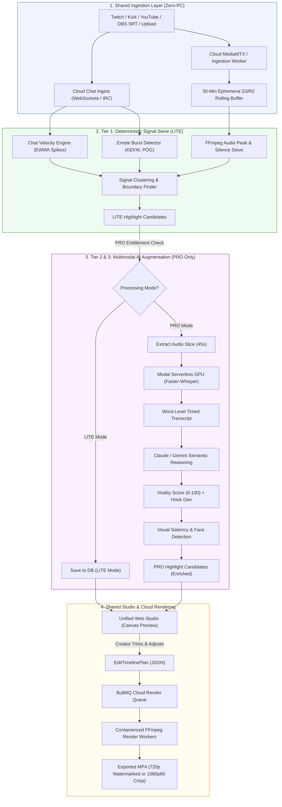
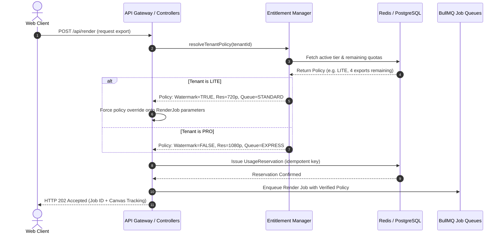
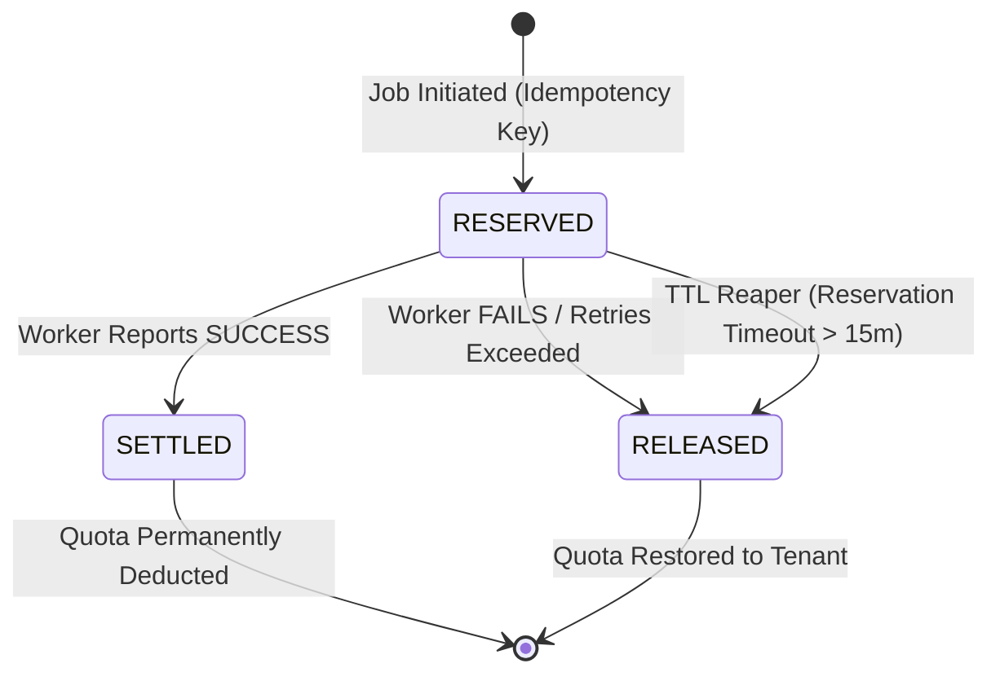

# AUTOAI EDIT — LITE & PRO UNIFIED PROCESSING ARCHITECTURE

**Document ID:** ARCH-018  
**Version:** 1.0.0-PROD  
**Target Repository:** `https://github.com/RIPU05/autoedit-ai`  
**Classification:** Core System Architecture & SaaS Monetization Strategy  
**Author:** Principal Software Architect, Video Infrastructure Architect, SaaS Product Architect & Billing Systems Lead  

---

## 1. Executive Summary & Core Philosophy

### 1.1 One Product, Two Processing Modes
AutoAI Edit is designed as **one unified web application** serving creators across their entire content lifecycle. It does not fork into two competing codebases, siloed applications, or separate databases. Instead, it provides two distinct, configuration-driven **Processing Modes**:

1. **LITE Mode:** Low-cost, cloud-native livestream and recorded-video clipping. Operates on deterministic signal processing (chat velocity, emote surges, audio silence/peaks, creator bookmarks) running entirely on CPU workers at near-zero inference cost.
2. **PRO Mode:** Premium, studio-grade multimodal AI editing. Augments deterministic signals with serverless GPU Faster-Whisper transcription, Claude/Gemini semantic reasoning, automated virality scoring, smart computer-vision reframing, and animated karaoke captions.

```text
┌─────────────────────────────────────────────────────────────────────────────┐
│                       ONE UNIFIED WEB APPLICATION                           │
│   (Shared Next.js Frontend • Shared NestJS/Express API • Shared Database)   │
└──────────────────────────────────────┬──────────────────────────────────────┘
                                       │
            ┌──────────────────────────┴──────────────────────────┐
            ▼                                                     ▼
┌───────────────────────────────┐     ┌───────────────────────────────┐
│        LITE PIPELINE          │     │         PRO PIPELINE          │
│  • Deterministic Signal Sieve │     │  • Tier 1 Sieve (from LITE)   │
│  • Chat EWMA Velocity Spikes  │     │  • Faster-Whisper GPU Transc. │
│  • Emote Density & Silence    │     │  • Gemini/Claude LLM Reasoning│
│  • Ephemeral CPU Transcode    │     │  • Smart Face Reframing       │
│  • Static/Burned Subtitles    │     │  • Dynamic Karaoke Subtitles  │
│  • Cost: ~$0.03 - $0.05/clip  │     │  • Cost: ~$0.13 - $0.15/clip  │
└───────────────┬───────────────┘     └───────────────┬───────────────┘
                │                                     │
                └──────────────────┬──────────────────┘
                                   ▼
┌─────────────────────────────────────────────────────────────────────────────┐
│                         ONE UNIFIED WEB STUDIO                              │
│  (Instant HTML5 Canvas Preview • Explainable AI • Non-Destructive History)  │
└─────────────────────────────────────────────────────────────────────────────┘
```

### 1.2 Core Architectural Invariants
Both processing modes strictly adhere to the five core product invariants of AutoAI Edit:
1. **Zero Creator PC Burden:** 100% cloud-hosted; neither mode requires local desktop software, background daemons, or local GPU rendering.
2. **Instant Preview Edit:** Edits, cuts, and framing adjustments are rendered client-side on HTML5 canvas with zero cloud render wait time.
3. **Explainable AI:** Every highlight candidate generated displays verifiable signal evidence (chat velocity curves, acoustic energy, or LLM reasoning).
4. **Non-Destructive Version History:** Trims, aspect ratios, overlays, and upgrades are stored as immutable operation logs (`EditTimelinePlan`); source media is never altered.
5. **Seamless Upgrade Refinement:** A creator can review a LITE highlight and click "Enhance with PRO AI" to trigger GPU transcription and LLM virality analysis on that isolated segment without re-uploading or recreating project state.

---

## 2. End-to-End User Journeys

### 2.1 Journey A: The Free / LITE Creator
1. **Sign Up & Account Setup:** The creator signs up on `autoedit-ai.vercel.app`. They are automatically provisioned a tenant record with the `LITE` entitlement policy.
2. **Media Connection:**
   - *Option A (Live):* Connects Twitch or Kick channel via authorized OAuth or inputs their stream channel name.
   - *Option B (Upload):* Uploads a 1-hour pre-recorded MP4 gameplay or podcast file.
   - *Option C (OBS Direct):* Copies their personalized RTMPS stream key into OBS Studio and streams directly to AutoAI Edit's cloud MediaMTX ingest node.
3. **Live Monitoring & Ingestion:**
   - AutoAI Edit captures incoming stream chunks into a 30-minute ephemeral S3/R2 rolling buffer.
   - The lightweight Cloud Chat Monitor connects to Twitch IRC or Kick Pusher WebSockets, recording message timestamps and emote events.
4. **Deterministic Highlight Detection:**
   - The LITE Signal Engine tracks Exponentially Weighted Moving Average (EWMA) chat velocity and emote bursts (e.g., `KEKW`, `POG`, `W`).
   - Concurrently, FFmpeg `silencedetect` identifies high-energy audio peaks following quiet gameplay moments.
   - Highlight candidates are generated in the database with `ProcessingMode.LITE` and transparent signal evidence.
5. **Review in Unified Studio:**
   - The creator opens the project in the web studio. Highlight candidates appear on the timeline marked with chat spikes.
   - Scrubbing and previewing occur instantaneously via HTML5 canvas.
   - The creator trims the start/end points, selects a 9:16 vertical crop preset, and chooses standard static burned subtitles.
6. **Export & Download:**
   - The creator clicks "Export Clip". The server verifies the tenant has available LITE export quota, issues a non-blocking `UsageReservation`, and dispatches a CPU transcode job to the BullMQ cluster.
   - Within 30–60 seconds, the 720p/1080p MP4 (with a tasteful AutoAI Edit watermark) is available for direct download.

### 2.2 Journey B: The PRO Creator
1. **Subscription & High-Quota Provisioning:** The creator subscribes to the PRO plan, granting expanded video buffer leases, 4K/1080p60 unwatermarked exports, and GPU/LLM intelligence quotas.
2. **Multimodal Ingestion & High-Precision Sieve:**
   - Media flows through the same cloud ingestion pipeline.
   - In addition to chat velocity and audio peaks, the PRO Highlight Engine routes high-signal clusters to the serverless GPU worker (Modal Faster-Whisper) for high-accuracy word-level transcription.
3. **Semantic LLM Reasoning:**
   - Structured transcripts, chat curves, and audio energy are evaluated by Claude 3.5 / Gemini 1.5 Flash.
   - The LLM identifies comedic payoffs, emotional pivots, viral hooks, and generates an algorithmic **Virality Score (0–100)**, an explanation paragraph, and three platform-optimized social media titles/hooks.
4. **Advanced Editing in Studio:**
   - The creator reviews clips ranked by virality score.
   - Automatic computer-vision speaker tracking centers the webcam or speaker dynamically in 9:16 portrait orientation.
   - Word-level animated karaoke captions (e.g., MrBeast-style bouncing text with active word highlights) are rendered live in the canvas.
5. **Multi-Platform Publishing:**
   - The creator exports in crisp 1080p60 without watermarks and schedules direct one-click publishing to TikTok, YouTube Shorts, and Instagram Reels.

### 2.3 Journey C: LITE-to-PRO Upgrade Refinement
1. A LITE creator discovers an exceptional highlight generated via chat spike detection.
2. Inside the Studio, a prominent prompt states: *"Enhance this clip with PRO AI: Word-level Karaoke Captions & Virality Analysis."*
3. The creator clicks "Enhance with PRO AI".
4. **Server Verification & Idempotent Reservation:** The system checks if the creator has PRO credits or offers an inline checkout/trial upgrade. A `UsageReservation` is created for the upgrade.
5. **Targeted Segment Inference:** The system *does not* re-process the entire 4-hour stream. Instead, it extracts the exact sub-clip time range (e.g., `01:14:20.000` to `01:15:05.000`) and dispatches only those 45 seconds to Faster-Whisper and the LLM engine.
6. **Non-Destructive State Fusion:**
   - The existing `EditTimelinePlan` receives a new immutable snapshot in `EditVersionHistory`.
   - The newly generated word-level transcript and AI hook options are attached to the existing clip.
   - The creator's manual trims and visual framing presets remain 100% intact.

---

## 3. Dual-Pipeline Architecture & Dataflow



---

## 4. Comprehensive Feature Comparison Matrix

| Feature Category | Capability / Attribute | LITE Processing Mode | PRO Processing Mode |
| :--- | :--- | :--- | :--- |
| **INGEST** | Supported Media Sources | Video Uploads, Twitch, Kick, YouTube, OBS Direct | Video Uploads, Twitch, Kick, YouTube, OBS Direct |
| **INGEST** | Hardware Requirement | Zero Local PC (100% Cloud) | Zero Local PC (100% Cloud) |
| **LIVE** | Rolling Buffer Retention | 30-minute sliding buffer; 2-hour post-stream lease | 30-minute sliding buffer; 24-hour post-stream lease |
| **LIVE** | Concurrent Livestreams | 1 Active Stream per account | Up to 3 Simultaneous Streams (Multi-POV) |
| **CLIPPING** | Detection Signals | Chat EWMA velocity, emote surges, audio peaks | Chat + Audio + Word Transcript + LLM Semantics |
| **CLIPPING** | Detection Speed | Real-time / Near-instant (<5 seconds post-spike) | Near-real-time (15–30 seconds for GPU/LLM) |
| **AI** | Speech Transcription | None (or basic static subtitle pass) | Word-level timestamped Faster-Whisper GPU |
| **AI** | Semantic Virality Scoring | None | Algorithmic 0–100 score with hook reasoning |
| **AI** | Social Title & Hook Generation | None (Default stream title) | 3 AI-generated hooks optimized for TikTok/Shorts |
| **EDIT** | Preview Editing | Instant client-side HTML5 canvas | Instant client-side HTML5 canvas |
| **EDIT** | Smart Face / Speaker Reframing | Manual crop or static 9:16 framing presets | Computer-vision active speaker tracking |
| **EDIT** | Version History | 5 snapshots per project | Unlimited non-destructive version snapshots |
| **CAPTIONS** | Subtitle Styles | Burnt-in standard static white/yellow text | Word-by-word animated karaoke, custom fonts/colors |
| **EXPORT** | Maximum Resolution & Framerate | 720p @ 30fps or 1080p @ 30fps | 1080p @ 60fps or 4K @ 60fps |
| **EXPORT** | Platform Watermark | Tasteful AutoAI Edit corner badge | Zero Watermark (100% Whitelabel) |
| **EXPORT** | Direct Social Publishing | Manual MP4 download | Direct 1-Click Publishing to TikTok / YouTube |
| **REFERENCE** | Reference Style Transfer | Basic: $\le 60\text{s}$ ref video, 3 analyses/mo, ASL pacing & preset captions | Advanced: $\le 10\text{min}$ ref video, 50 analyses/mo, full OCR typography, optical zooms, profile library |
| **SAAS** | Cloud Processing Economics | Free / Ultra-Low-Cost Tier | Paid Monthly / Annual Subscription |
| **SAAS** | Render Queue Priority | Standard CPU Queue | High-Priority Express Worker Queue |

---

## 5. Shared Contracts Specification

To ensure seamless interoperability without database bifurcation, the `@autoedit/contracts` package defines the domain models governing both modes.

### 5.1 ProcessingMode & ProcessingPolicy Schema
```typescript
import { z } from 'zod';

export const ProcessingModeSchema = z.enum(['LITE', 'PRO']);
export type ProcessingMode = z.infer<typeof ProcessingModeSchema>;

export const ProcessingPolicySchema = z.object({
  mode: ProcessingModeSchema,
  maxInputDurationMinutes: z.number().positive(),
  maxExportDurationSeconds: z.number().positive(),
  maxMonthlyExports: z.number().int().nonnegative(),
  maxConcurrentLiveSessions: z.number().int().positive(),
  bufferRetentionHours: z.number().positive(),
  allowGpuTranscription: z.boolean(),
  allowLlmSemanticAnalysis: z.boolean(),
  allowAnimatedKaraokeSubtitles: z.boolean(),
  allowSmartFaceTracking: z.boolean(),
  exportMaxResolution: z.enum(['720p', '1080p', '4k']),
  exportMaxFramerate: z.enum(['30fps', '60fps']),
  watermarkRequired: z.boolean(),
  queuePriority: z.enum(['STANDARD', 'HIGH', 'EXPRESS']),
});
export type ProcessingPolicy = z.infer<typeof ProcessingPolicySchema>;
```

### 5.2 HighlightCandidate & Multimodal Evidence Schema
```typescript
export const HighlightEvidenceSchema = z.object({
  chatVelocityRatio: z.number().nonnegative().optional(), // e.g. 3.4x baseline
  dominantEmotes: z.array(z.string()).optional(),         // ['KEKW', 'LUL']
  audioEnergyDb: z.number().optional(),                   // -12.4 dB peak
  silencePrecedingSeconds: z.number().nonnegative().optional(),
  transcriptSnippet: z.string().optional(),
  llmViralityScore: z.number().min(0).max(100).optional(),
  llmReasoning: z.string().optional(),
  suggestedHooks: z.array(z.string()).optional(),
  detectedSpeakerFaceCoordinates: z.object({
    x: z.number(),
    y: z.number(),
    width: z.number(),
    height: z.number(),
  }).optional(),
});
export type HighlightEvidence = z.infer<typeof HighlightEvidenceSchema>;

export const HighlightCandidateSchema = z.object({
  id: z.string().uuid(),
  tenantId: z.string().uuid(),
  mediaSourceId: z.string().uuid(),
  sessionId: z.string().uuid().optional(),
  processingMode: ProcessingModeSchema,
  startOffsetMs: z.number().int().nonnegative(),
  endOffsetMs: z.number().int().positive(),
  durationMs: z.number().int().positive(),
  confidenceScore: z.number().min(0).max(1),
  evidence: HighlightEvidenceSchema,
  isReviewed: z.boolean(),
  createdAt: z.string().datetime(),
});
export type HighlightCandidate = z.infer<typeof HighlightCandidateSchema>;
```

### 5.3 UpgradeRefinementRequest Schema
```typescript
export const UpgradeRefinementRequestSchema = z.object({
  requestId: z.string().uuid(),
  tenantId: z.string().uuid(),
  highlightCandidateId: z.string().uuid(),
  targetStartOffsetMs: z.number().int().nonnegative(),
  targetEndOffsetMs: z.number().int().positive(),
  enableGpuTranscription: z.boolean().default(true),
  enableLlmViralityAnalysis: z.boolean().default(true),
  enableSmartReframing: z.boolean().default(true),
  idempotencyKey: z.string().min(16),
});
export type UpgradeRefinementRequest = z.infer<typeof UpgradeRefinementRequestSchema>;
```

---

## 6. Configuration-Driven Entitlement & Server-Side Enforcement

### 6.1 Architectural Principle: Never Trust the Client
A fundamental security and operational vulnerability in SaaS applications is trusting frontend UI toggles to dictate processing tiers. In AutoAI Edit:
1. **Server-Side Authorization Gate:** Every API route (`POST /api/jobs/create`, `POST /api/highlights/detect`, `POST /api/render`) resolves the tenant's current active entitlement from Redis/Database.
2. **Policy Configuration Object:** Processing parameters (e.g., `allowGpuTranscription`, `watermarkRequired`) are injected by the server-side entitlement resolver, not accepted from client payloads.
3. **Payload Sanitization:** If a `LITE` tenant crafts an HTTP request attempting to dispatch a `PRO` job, the server-side validator rejects the request with HTTP `403 Forbidden: EntitlementLimitExceeded`.



---

## 7. Quota Strategy, Idempotent Accounting & Double-Charge Protection

### 7.1 Separate Allowances for Chat Monitoring vs. Video Ingestion
A key operational insight is that **chat monitoring and video ingest have wildly divergent cost profiles**:
- **Chat Monitoring:** Uses lightweight WebSocket/IRC packets. 100 hours of chat monitoring consumes less than 50MB of cloud bandwidth and negligible CPU, costing `<$0.01`.
- **Video Ingestion & Storage:** 1080p60 video ingested via RTMP at 6 Mbps consumes ~2.7 GB per hour of cloud ingress, ephemeral rolling buffer storage, and chunk demuxing, costing `~$0.04 - $0.08` per hour.

Therefore, the quota system enforces **independent metering pools**:
1. `chat_monitoring_hours`: Generous allocation (e.g., 50 hours/month on LITE).
2. `video_capture_hours`: Strictly bounded (e.g., 2 hours/month on LITE, 30 hours/month on PRO).
3. `ai_gpu_minutes`: Zero on LITE; metered per audio minute on PRO.
4. `rendered_exports`: Unit count per billing cycle.

### 7.2 The Reservation Pattern (Idempotent Quota Accounting)
To prevent creators from being charged twice during transient worker failures, network retries, or server restarts, quota consumption follows a two-phase reservation pattern:



1. **Reservation Phase:** When a job is accepted, the API writes a `UsageReservation` record to Redis with a 15-minute TTL:
   `reservation_key = res:{tenantId}:{idempotencyKey}`.
   The tenant's available balance is temporarily decremented.
2. **Settlement Phase:** Upon successful completion and S3 artifact write, the worker publishes a `job.completed` event. The system promotes the reservation to an immutable `UsageEvent` (`SETTLED`) in PostgreSQL.
3. **Release Phase (Failure Safety):** If the transcode or AI inference worker fails (e.g., OOM, upstream API timeout), the worker publishes `job.failed`. The system drops the reservation (`RELEASED`), immediately restoring the creator's quota balance.
4. **Idempotency Guarantee:** If the client retries an identical request (e.g., due to a dropped mobile Wi-Fi connection), the API recognizes the existing `idempotencyKey` and returns the existing job ID without creating a secondary reservation.

---

## 8. Cloud Unit Economics & Target Cost Drivers (Hypotheses)

> [!NOTE]
> **Engineering Cost Hypotheses & Benchmark Targets:** The cost models, inference latencies (e.g. ~3.2s for 45s audio), and transcode durations below represent **theoretical engineering hypotheses and design benchmarks** based on cloud provider pricing. **Retail subscription pricing, free-tier limits, and packaging remain undecided** and will be calibrated during Milestone 4/5 beta testing.

### 8.1 Benchmark Cost Breakdown per Component (Target Hypothesis)

| Component | Cost Driver | LITE Mode Target Benchmark | PRO Mode Target Benchmark | Optimization / Mitigation |
| :--- | :--- | :--- | :--- | :--- |
| **Ingress Bandwidth** | MediaMTX RTMP/SRT stream ingest | $0.005 (AWS/Cloudflare free ingress) | $0.005 | Cloudflare R2 / Render zero-cost ingress |
| **Rolling Buffer** | 30m ephemeral chunk storage (S3/R2) | $0.002 (30-min TTL lifecycle rule) | $0.004 (Higher bitrate / 1080p) | Auto-deleted via S3 lifecycle after 2 hours |
| **Signal Ingest** | WebSockets/IRC chat connection | $0.0001 (Multiplexed connections) | $0.0001 | Single process monitors 500+ chats via asyncio/Node |
| **Highlight Engine** | EWMA velocity & silence calculation | $0.0005 (CPU memory arithmetic) | $0.0005 | Performed in-memory during ingest |
| **GPU Inference** | Faster-Whisper transcription | **$0.0000 (Not used in LITE)** | **$0.0450 (Modal A10G @ $0.00028/sec)** | 45-second segment transcribed in ~3.2s benchmark |
| **LLM Inference** | Claude 3.5 Haiku / Gemini 1.5 Flash | **$0.0000 (Not used in LITE)** | **$0.0150 (Tokens for transcript & hooks)** | Structured output caching & compact prompt |
| **CPU Transcode** | FFmpeg vertical crop + static captions | $0.0180 (Render CPU worker: ~35s transcode) | $0.0350 (1080p60 + multi-layer transcode) | FFmpeg `-threads 2 -preset veryfast` |
| **Egress Bandwidth** | User download of final MP4 | $0.0040 (Cloudflare R2 zero-egress CDN) | $0.0080 | R2 storage eliminates S3 egress penalty |
| **Storage Lease** | 7-day retention of exported MP4 | $0.0010 (50MB MP4) | $0.0020 (150MB MP4) | Lease expiration deletes raw assets after 7 days |
| **Total Benchmark Cost**| **Fully loaded target unit cost** | **~$0.03 per clip (Target)** | **~$0.11 per clip (Target)** | **~3.7x cost efficiency for LITE** |

### 8.2 Working Hypotheses for Free / LITE Tier Quotas
To ensure economic sustainability without runaway cloud bills, the following initial free-tier caps are established as operational hypotheses:
- **Mandatory Safety Precondition:** Durable quota enforcement and server-side entitlement validation (`SAAS-009`, `AUTH-005`) are deployed in Milestone 1 *prior* to opening any public free cloud processing.
- **Monthly Video Capture Limit:** 2 hours total streaming / video upload per calendar month.
- **Chat Monitoring Allowance:** 20 hours total chat monitoring per month.
- **Highlight Generation:** Unlimited LITE candidate detection.
- **Monthly Rendered Exports:** 5 watermarked 720p clips per month.
- **Storage Lease:** Exported clips retained for 72 hours (with email reminder prior to reclamation).
- **Economic Safety Factor:** Maximum cloud cost exposure per active free user = `~$0.25/month` (target hypothesis).

---

## 9. Security, BOLA & Platform API/ToS Boundaries

### 9.1 Broken Object-Level Authorization (BOLA) Safeguards
Because livestream and video editing involves private assets, stream keys, and user media, strict BOLA protection is enforced across all routes:
1. **Tenant-Isolated Queries:** Every Prisma/SQL query includes `WHERE tenantId = :authenticatedTenantId`.
2. **Stream Key Obfuscation:** Ingest stream keys (`rtmp://ingest.autoedit.com/live/{streamKey}`) are cryptographically random 256-bit tokens hashed via SHA-256 in the database.
3. **Ephemeral Pre-Signed URLs:** S3/R2 download URLs for preview chunks and exported MP4s have a maximum expiration of 15 minutes and require valid session cookies.

### 9.2 Platform API & Terms of Service Boundaries (Link-First vs. Identity)
AutoAI Edit maintains strict adherence to third-party developer policies across all platforms (see [`ARCH-006: 6-Facet Boundary Analysis`](file:///c:/Users/RIPS/Desktop/autoeditAI/autoedit-ai/docs/architecture/06-LIVESTREAM-INGESTION-ARCHITECTURE.md)):
1. **Link-First Access Decoupled from Identity:** Users can paste public livestream or video URLs (Twitch, YouTube, Kick) or upload files without connecting personal platform accounts. Account OAuth is requested only where a specific platform operation requires it.
2. **Twitch API & IRC Guidelines:**
   - Public chat monitoring utilizes open IRC WebSocket protocols (`irc.chat.twitch.tv:6667`).
   - Broadcaster EventSub and clip creation require explicit OAuth tokens.
   - **Critical Boundary:** The system never promises or displays rendered video clips if only chat events exist without authorized video ingress (via OBS or user upload). If video capture is disabled or forbidden, the UI explicitly renders a "Chat Activity Timeline" without fabricating video cuts.
3. **Kick Platform Boundaries:**
   - Connects to public Pusher WebSocket streams for chat spike analysis without login.
   - Does not attempt to bypass Cloudflare Turnstile or scrape restricted internal endpoints. Full video rendering requires direct OBS broadcast or user file upload.
4. **YouTube Data API & Terms:**
   - Adheres strictly to YouTube quota limits.
   - Does not attempt automated raw video file downloads (which violates YouTube ToS Section 5.B). Video rendering requires direct OBS feed or user video upload.
   - Respects all content takedown and deletion notifications via webhook within 24 hours.

---

## 10. Failure Handling, Edge Cases & Graceful Degradation

### 10.1 Quiet Chats (Low Concurrent Viewer Streams)
- **Challenge:** A streamer with 5–15 viewers may not generate sudden 40-message chat spikes, causing pure chat-spike algorithms to yield zero clips.
- **Mitigation:**
  1. The LITE Sieve dynamically calibrates EWMA velocity to the channel's personal historical baseline (e.g., detecting a jump from 0.2 msgs/min to 2.0 msgs/min).
  2. Fallback to **Audio Peak Sieve**: FFmpeg analyzes volume surges (e.g., streamer shouting or laughing after a period of quiet game audio).
  3. Support for **Creator Bookmarks**: The streamer can trigger an instant clip bookmark via a Twitch chat command (e.g., `!clip`) or an OBS hotkey.

### 10.2 Chat Spam, Emote Floods & Raid Manipulation
- **Challenge:** A raid of 500 viewers or a copy-paste spam bot wave can artificially spike chat velocity without genuine stream content.
- **Mitigation:**
  - **Unique Chatter Ratio:** Chat velocity is weighted by the number of unique user IDs sending messages. 100 messages from 2 accounts are heavily penalized.
  - **Emote Diversity:** Repetitive identical strings are throttled via an in-memory sliding Bloom filter.

### 10.3 Graceful AI Degradation (PRO Mode Outages)
- **Challenge:** If Modal GPU workers or Claude/Gemini API endpoints experience third-party outages or rate limits:
- **Degradation Path:**
  1. The system automatically falls back to LITE deterministic candidates.
  2. The candidate is flagged in the Studio as *"Candidate generated via LITE signals (PRO AI temporarily unavailable)"*.
  3. Any reserved PRO GPU/LLM quota is immediately released back to the tenant's account with zero penalty.
  4. An inline button allows the creator to re-try PRO refinement once upstream AI services recover.

---

## 11. Incremental Implementation Roadmap & Acceptance Test Plan

### 11.1 Implementation Phases
- **Phase 1: Shared Code Foundation (Completed in Milestone 0A)**
  - `@autoedit/contracts` package published with `ProcessingMode`, `HighlightCandidate`, and `UsageReservation`.
- **Phase 2: LITE Engine Implementation (Milestone 3)**
  - Implement Cloud Chat Monitor (Twitch IRC / Kick Pusher).
  - Implement EWMA chat velocity & FFmpeg `silencedetect` sieve.
  - Integrate LITE candidate generation into Studio timeline.
- **Phase 3: PRO Multimodal AI Integration (Milestone 4)**
  - Connect Modal Faster-Whisper GPU worker to candidate audio segments.
  - Implement Claude/Gemini semantic reasoning and virality scoring.
  - Implement word-level animated karaoke subtitle renderer.
- **Phase 4: Upgrade Refinement & SaaS Quotas (Milestone 5)**
  - Server-side entitlement manager & Redis reservation reaper.
  - Studio 1-click "Enhance with PRO AI" non-destructive workflow.

### 11.2 Acceptance Test Plan
| Test ID | Test Scenario | Expected Outcome |
| :--- | :--- | :--- |
| **TEST-LITE-01** | Feed synthetic Twitch IRC chat log with 4x message surge into LITE Sieve | Correct `HighlightCandidate` created with `ProcessingMode = 'LITE'`, correct timestamps, and evidence object. |
| **TEST-LITE-02** | Request export as LITE user | BullMQ job enqueued with watermark flag, standard priority, and 720p limit. Quota reservation recorded. |
| **TEST-PRO-01** | Feed identical media into PRO pipeline | Faster-Whisper called on segment; Claude generates virality score (0-100) and 3 hooks; word-level transcript populated. |
| **TEST-UPGRADE-01**| Trigger `UpgradeRefinementRequest` on existing LITE highlight | Original LITE candidate preserved; new PRO version created in `EditVersionHistory`; trims retained; quota reserved. |
| **TEST-QUOTA-01** | Simulate worker crash during PRO rendering | Reservation TTL expires or failure handler catches error; tenant quota balance fully restored without double charge. |
| **TEST-BOLA-01** | Tenant A attempts to read or export Tenant B's LITE candidate | API returns HTTP 404/403; access strictly denied. |
| **TEST-TOS-01** | Twitch chat monitored without active video stream | System registers chat activity timeline but cleanly disables video rendering buttons with explanatory notice. |
