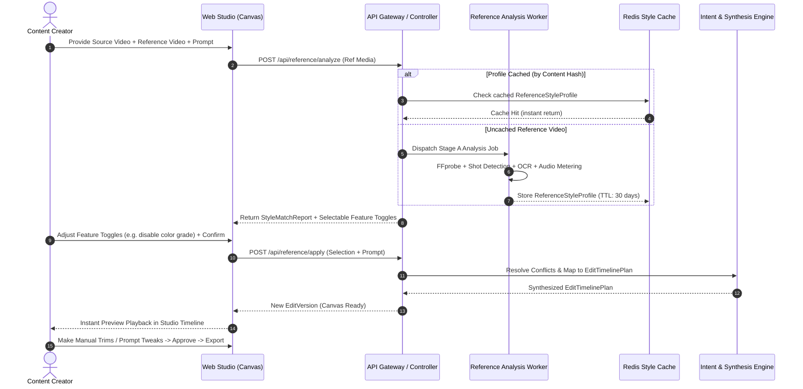
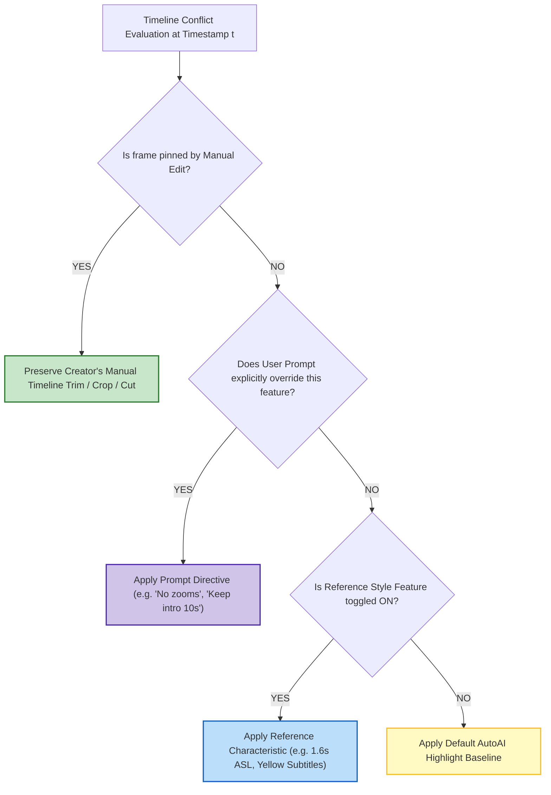

# AUTOAI EDIT — REFERENCE-BASED AI EDITING ARCHITECTURE

**Document ID:** ARCH-019  
**Version:** 1.0.0-PROD  
**Target Repository:** `https://github.com/RIPU05/autoedit-ai`  
**Classification:** Core System Architecture & AI Video Engineering Specification  
**Author:** Principal AI Video Engineer, Video Editing Architect, Computer Vision Engineer & Senior TypeScript Architect  

---

## 1. Executive Summary & Core Philosophy

### 1.1 One Unified Studio, Four Composable Editing Paradigms
AutoAI Edit is designed as **one unified content platform** for independent clippers, streamers, digital creators, and everyday video editors. It does not introduce a fragmented secondary application or separate editing engine for reference workflows.

Within the same Web Studio, creators can seamlessly utilize and interleave four composable editing paradigms:

1. **AUTO EDIT:** Algorithmic highlight extraction and silence reduction based on multimodal signal spikes (chat velocity, audio energy, speech pacing).
2. **PROMPT EDIT:** Conversational natural-language refinement ("Make the pacing punchier", "Zoom in on funny moments", "Remove awkward pauses").
3. **REFERENCE EDIT:** Style-conditioned editing that analyzes an exemplar video (uploaded MP4 or supported public URL) and applies its pacing, typography, zoom timing, and composition to source media.
4. **MANUAL EDIT:** Pixel-accurate, client-side HTML5 canvas timeline manipulation (trimming, keyframing, cropping, text customization).

```text
┌─────────────────────────────────────────────────────────────────────────────┐
│                         ONE UNIFIED WEB STUDIO                              │
├─────────────────────────────────────────────────────────────────────────────┤
│  [Source Video] ──► Upload MP4 / Paste Supported Link / Live Stream         │
│  [Reference]   ──► Upload Style Video / Paste Exemplar Link                 │
│  [Prompt]      ──► "Match pacing and captions, but keep original audio"     │
└──────────────────────────────────────┬──────────────────────────────────────┘
                                       │
                                       ▼
┌─────────────────────────────────────────────────────────────────────────────┐
│                 REFERENCE-CONDITIONED TIMELINE SYNTHESIS                    │
│                                                                             │
│   ┌───────────────┐     ┌───────────────┐     ┌───────────────┐             │
│   │   AUTO EDIT   │ ──► │REFERENCE EDIT │ ──► │  PROMPT EDIT  │             │
│   │(Highlight Cut)│     │(Pacing/Zooms) │     │ (Override UI) │             │
│   └───────────────┘     └───────────────┘     └───────────────┘             │
│                                 │                                           │
│                                 ▼                                           │
│             Deterministic Conflict Resolution Matrix                        │
│   (Manual Pinned > Prompt Overrides > Reference Style > Auto Baseline)      │
└──────────────────────────────────────┬──────────────────────────────────────┘
                                       │
                                       ▼
┌─────────────────────────────────────────────────────────────────────────────┐
│                         UNIFIED EditTimelinePlan                            │
│  (Instant Canvas Preview • Explainable Style Report • Version History)      │
└─────────────────────────────────────────────────────────────────────────────┘
```

### 1.2 Non-Negotiable Architectural Invariants
Reference-based editing strictly adheres to AutoAI Edit's proven core invariants:
1. **Zero Creator PC Burden:** All reference decomposition, keyframe extraction, and style mapping execute 100% in cloud workers.
2. **Instant Preview Edit (`EDIT-001`):** Applying a reference style immediately compiles an `EditTimelinePlan` rendered client-side on HTML5 canvas; the creator never waits for an expensive cloud video transcode to preview the style.
3. **Explainable AI (`EDIT-002`):** Every matched attribute is detailed in a transparent **Style Match Report** explaining what was matched, what was adapted, and what could not be replicated.
4. **Non-Destructive Version History (`EDIT-003`):** Applying, modifying, or reverting a reference style generates an immutable `EditVersion` snapshot without altering original media or discarding prior manual trims.
5. **No Mandatory Platform Lock-In:** Ordinary video editing requires zero third-party account connections. Platform OAuth (Twitch, YouTube, Kick) is requested only when a live ingestion or direct-publishing action explicitly demands it.

---

## 2. End-to-End User Experience

### 2.1 User Input Structure
To initiate a Reference-Based Edit, the creator provides three inputs:
1. **Original Video:** The target raw footage to edit (uploaded MP4/MOV or supported link).
2. **Reference Video:** An exemplar video demonstrating the desired editing aesthetic (uploaded MP4 or supported platform link).
3. **Optional Natural-Language Directives:** User instructions qualifying which aspects to mirror or avoid.
   *Example:* *"Make my gaming clip edit like this TikTok reference. Match the rapid-fire zoom cuts and bold yellow subtitle styling, but keep my original game audio and do not apply color saturation filters."*

### 2.2 Operational Flow


1. **Step 1 — Ingestion & Cache Check:** Reference video is probed. If the video's content hash matches an existing profile in the cache (e.g., a viral TikTok template analyzed previously), the profile is reused instantly at $0 compute cost.
2. **Step 2 — Reference Analysis (Stage A):** The reference worker extracts shot lengths, cut rhythm, subtitle bounding boxes/typography, optical zooms, and audio loudness dynamics.
3. **Step 3 — Style Match Report Presentation:** The Web Studio displays an interactive breakdown:
   - *Pacing:* Average shot length (e.g., 1.4s fast-paced cuts).
   - *Subtitles:* Bottom-center, bold italic, yellow text with black stroke, word-level bounce.
   - *Zooms:* 1.25x punch zooms on acoustic volume peaks.
   - *Unsupported:* Proprietary 3D motion graphics or copyrighted audio assets flagged with explanatory notices.
4. **Step 4 — Selective Style Matching & Prompt Override:** The creator toggles which dimensions to inherit and inputs optional refinement text.
5. **Step 5 — Style Application & Synthesis (Stage B):** The engine merges the reference profile with the source footage's acoustic/semantic boundaries, yielding an `EditTimelinePlan`.
6. **Step 6 — Instant Preview & Iteration:** The creator reviews the cut on the HTML5 canvas, scrubs waveforms, and tweaks individual cut boundaries before submitting for final cloud export.

---

## 3. Reference Analysis Capabilities & Technical Boundaries

To maintain engineering integrity, reference analysis features are partitioned into four distinct technological classifications:

```text
┌─────────────────────────────────────────────────────────────────────────────┐
│                    REFERENCE ANALYSIS CAPABILITY MATRIX                     │
├───────────────────────────────┬─────────────────────────────────────────────┤
│ 1. Deterministic Mathematics  │ 2. Computer Vision (CV)                     │
│  • Scene cuts & shot duration │  • Optical flow & camera zoom vectors       │
│  • Cut pacing & rhythm (ASL)  │  • Subtitle OCR, typography & placement     │
│  • Aspect ratio & letterbox   │  • Facecam & split-screen spatial layout    │
│  • Audio loudness & onset peak│  • Transition type (crossfade, whip, hard)  │
│  • Silence & pause boundaries │  • Dominant color grade & contrast palette  │
├───────────────────────────────┼─────────────────────────────────────────────┤
│ 3. Semantic AI Understanding  │ 4. Non-Reproducible (Excluded by Design)    │
│  • Hook structure & arc timing│  • Proprietary 3D After Effects animations  │
│  • Comedic / dramatic beats   │  • Copyrighted background music tracks      │
│  • Contextual sound effect cue│  • Manual green-screen rotoscoping layers   │
│  • Virality intent classifier │  • Unique human personality / comedic delivery│
└───────────────────────────────┴─────────────────────────────────────────────┘
```

### 3.1 Category 1: Deterministically Measurable Characteristics
These properties are extracted with 100% mathematical precision via FFmpeg/FFprobe at ultra-low CPU cost:
- **Scene Cuts & Shot Boundaries:** Extracted via FFmpeg `select='gt(scene,0.3)'` filter and frame timestamp diffs.
- **Pacing & Shot Duration Distribution:** Calculation of Average Shot Length (ASL), shot variance, and cadence:
  $$\text{ASL} = \frac{1}{N} \sum_{i=1}^{N} (t_{i} - t_{i-1})$$
  *Cadence Classification:* Hype/Fast ($<1.8\text{s}$), Standard Narrative ($2.0\text{s} - 4.5\text{s}$), or Deliberate/Exploratory ($>5.0\text{s}$).
- **Aspect Ratio & Framing Geometry:** Native resolution, display aspect ratio (16:9, 9:16, 1:1), and letterbox/pillarbox detection via `cropdetect`.
- **Acoustic Loudness & Beat Onset Dynamics:** Measured via `ebur128` momentary loudness, RMS energy envelopes, and high-frequency spectral flux indicating sound effect peaks.

### 3.2 Category 2: Computer Vision (CV) Measurable Characteristics
Extracted through targeted keyframe inspection and light computer vision models:
- **Optical Zoom & Camera Motion:** Frame-to-frame optical flow analysis (Farneback algorithm) detecting radial expansion vectors indicative of 1.1x–1.4x punch zooms.
- **Subtitle Layout, Placement & Typography:** OCR (Tesseract / PaddleOCR) applied to subtitle bounding boxes:
  - Spatial coordinates: Normalized bounding box $[x_{\text{min}}, y_{\text{min}}, w, h]$ (e.g., bottom-third center).
  - Typography: Detected font weight (heavy/black), capitalization (ALL_CAPS vs Title Case), primary fill color hex, outline stroke thickness, and drop shadow presence.
  - Word Pacing: Detected word duration and animated highlight behavior (karaoke bounce).
- **Split-Screen & Facecam Spatial Layouts:** YOLO face and body detection determining whether the reference video uses:
  - Full-screen gameplay with webcam overlay (bounding box tracked).
  - Vertical split-screen (top: facecam 45% height, bottom: gameplay 55% height).
- **Transition Classification:** Detecting hard cuts vs cross-dissolves vs black fades using inter-frame luminance deltas.
- **Color Temperature & Contrast Profile:** 3D color histogram extraction measuring mean saturation, luminance distribution, and color cast (warm vs cool LUT emulation).

### 3.3 Category 3: Semantic AI Understanding (LLM / VLM)
Processed through compact multimodal prompts (Claude 3.5 Haiku / Gemini 1.5 Flash):
- **Hook Structure & Arc Pacing:** Evaluates the introductory 3–8 seconds to determine hook strategy (e.g., *"In media res action snippet followed by title card and rewind"*).
- **Reaction Placement:** Identifies narrative pivots where visual zooms coincide with creator vocal punchlines.
- **Pacing Intent:** Translates subtle video flow into editing intentions (e.g., *"Snappy montage during travel; slow continuous shot during dialogue"*).

### 3.4 Category 4: Explicit Technological & Legal Guardrails
> [!CAUTION]
> **Anti-Plagiarism & Intellectual Property Boundaries:**
> 1. **No Asset Extraction:** The platform never rips, copies, or redistributes copyrighted background music tracks, sound effect files, watermarks, corporate logos, or graphic overlays from the reference video.
> 2. **Style vs. Content Separation:** AutoAI Edit abstracts structural style parameters (e.g., *"cut every 1.6s, place yellow 28pt subtitles at Y=82%, punch zoom on audio surges"*), applying these rules **exclusively to the user's own original footage**.
> 3. **No Perfect Cloning Guarantee:** Video editing is an art form. The system explicitly disclaims 1:1 pixel replication, setting realistic creator expectations around procedural style approximation.

---

## 4. Selective Style Matching & Conflict Resolution

### 4.1 Granular Style Selection Matrix
Creators have complete autonomy to selectively enable or disable matched attributes:

| Style Dimension | Extracted Reference Parameter | User Toggle | Default State | Fallback if Disabled |
| :--- | :--- | :--- | :--- | :--- |
| **Pacing & Cuts** | Target ASL (e.g. 1.6s), cut frequency | `matchPacing` | **Enabled** | Baseline silence cut / natural speech |
| **Subtitle Styling** | Font family, color, stroke, position, animation | `matchCaptions`| **Enabled** | AutoAI Edit default modern yellow |
| **Punch Zooms** | Zoom scale (1.2x), pan alignment, frequency | `matchZooms` | **Enabled** | Static framing / zero zooms |
| **Transitions** | Cut type (hard cut, cross-dissolve, dip to black)| `matchTransitions`| **Enabled** | Standard hard cut |
| **Spatial Framing** | 9:16 vertical crop, split-screen webcam layout | `matchFraming` | **Enabled** | AutoAI smart face-center crop |
| **Color Grading** | Contrast, saturation, warm/cool balance | `matchColors` | **Disabled** (opt-in) | Original footage colors untouched |
| **Audio Rhythm** | Cut-to-beat synchronization, volume ducking | `matchAudioRhythm`| **Enabled** | Standard dialogue normalization |

### 4.2 Deterministic Conflict Resolution Matrix
When multiple instructions or edits coincide on the exact same timeline frame, the engine applies a **strict 4-tier deterministic precedence hierarchy**:

$$\text{Level 1: MANUAL PINNED EDITS} \succ \text{Level 2: USER PROMPT OVERRIDES} \succ \text{Level 3: REFERENCE STYLE PROFILE} \succ \text{Level 4: AUTOMATIC BASELINE}$$



1. **Level 1 (Highest Authority) — Manual Pinned Edits:**
   If a creator has manually trimmed a clip, locked a crop window, or typed custom subtitle text in the Web Studio, that operation is flagged as `pinned: true`. The reference engine **cannot** overwrite, shift, or delete pinned segments.
2. **Level 2 — User Prompt Directives:**
   If the creator provides natural-language prompts alongside or after reference application (e.g., *"Make the intro faster, but don't zoom in on the second kill"*), prompt directives supersede reference style parameters.
3. **Level 3 — Reference Style Profile:**
   Reference-extracted rules (e.g., cut pacing, subtitle placement, punch zoom intensity) dictate timeline behavior for all non-overridden segments.
4. **Level 4 (Lowest Authority) — Automatic Baseline:**
   Standard system defaults (silence threshold at -30dB, default 9:16 center reframe) apply only where reference analysis provides no data.

---

## 5. Unified Editing Engine Integration

The reference editing subsystem does not alter the fundamental video processing pipeline. It compiles directly into the platform's core contract: `EditTimelinePlan`.

### 5.1 Composable Multi-Modal Editing Lifecycle
The following sequence illustrates how AutoAI Edit unifies all editing methods on a single project:

```text
[PROJECT INITIALIZATION]
  │  Source Video: 25-minute gaming stream recording
  │
  ▼
[PHASE 1: AUTO EDIT]
  │  AutoAI Highlight Engine flags top 3 high-energy candidate clusters (chat spikes, audio peaks)
  │  Timeline snapshot created: Version 1 (3 raw candidate cuts, 120s total duration)
  │
  ▼
[PHASE 2: REFERENCE EDIT APPLIED]
  │  Creator uploads a 30s viral TikTok clip as reference
  │  Stage A analysis extracts: 1.4s shot pacing, rapid 1.25x punch zooms, modern yellow bouncing text
  │  Engine maps parameters onto Version 1:
  │    - Subdivides long cuts into 1.4s rhythmic segments matching action peaks
  │    - Injects dynamic punch zooms on vocal peaks
  │    - Configures subtitle styles to match reference typography
  │  Timeline snapshot created: Version 2 (38s tight vertical reel)
  │
  ▼
[PHASE 3: PROMPT EDIT REFINEMENT]
  │  Creator types: "Make the intro 3 seconds shorter and remove the second zoom"
  │  Engine adjusts cut 1 offset by -3.0s and deletes zoom operation at t=14.2s
  │  Timeline snapshot created: Version 3
  │
  ▼
[PHASE 4: MANUAL EDIT POLISH]
  │  Creator drags subtitle position 20px higher to avoid covering in-game ammo HUD
  │  Subtitle position is flagged as 'pinned'
  │  Timeline snapshot created: Version 4
  │
  ▼
[PHASE 5: EXPORT & RENDER]
  │  Creator reviews seamless HTML5 canvas playback in Preview Edit -> Clicks 'Export'
  │  Cloud BullMQ worker renders final MP4 using standard FFmpeg filtergraph
```

---

## 6. Proposed Shared Contracts Specification

To support Reference-Based Editing without breaking changes to existing production systems, the following domain models are proposed for addition to `@autoedit/contracts` in Milestone 0B.

> [!NOTE]
> **Status Notice:** The schemas below are **PROPOSED ARCHITECTURAL SPECIFICATIONS** for implementation in Milestone 0B. In accordance with platform governance, they are classified as **Planned Only** until authored in `packages/contracts/src/reference.ts` and validated with unit tests.

### 6.1 Reference Media & Analysis Job Schemas
```typescript
import { z } from 'zod';
import {
  TenantIdSchema,
  ResourceIdSchema,
  MillisecondTimestampSchema,
  MediaTimeRangeSchema,
} from './common.js';

export const ReferenceSourceKindSchema = z.enum([
  'DIRECT_UPLOAD',
  'PUBLIC_URL',
]);
export type ReferenceSourceKind = z.infer<typeof ReferenceSourceKindSchema>;

export const ReferenceMediaAssetSchema = z.object({
  id: ResourceIdSchema,
  tenantId: TenantIdSchema,
  sourceKind: ReferenceSourceKindSchema,
  sourceUrl: z.string().url().optional(),
  s3Key: z.string().optional(),
  contentHashSha256: z.string().min(64).max(64),
  durationMs: MillisecondTimestampSchema,
  width: z.number().int().positive(),
  height: z.number().int().positive(),
  fps: z.number().positive(),
  createdAt: z.string().datetime(),
});
export type ReferenceMediaAsset = z.infer<typeof ReferenceMediaAssetSchema>;

export const ReferenceAnalysisJobSchema = z.object({
  jobId: ResourceIdSchema,
  tenantId: TenantIdSchema,
  referenceAssetId: ResourceIdSchema,
  status: z.enum(['QUEUED', 'ANALYZING_SHOTS', 'ANALYZING_CV', 'EXTRACTING_STYLE', 'COMPLETED', 'FAILED']),
  progressPercent: z.number().min(0).max(100),
  profileId: ResourceIdSchema.optional(),
  error: z.string().optional(),
  createdAt: z.string().datetime(),
  completedAt: z.string().datetime().optional(),
});
export type ReferenceAnalysisJob = z.infer<typeof ReferenceAnalysisJobSchema>;
```

### 6.2 Reference Style Profile & Extracted Features
```typescript
export const ReferenceStyleFeatureSchema = z.object({
  featureKey: z.enum([
    'PACING_ASL',
    'ZOOM_INTENSITY',
    'ZOOM_FREQUENCY',
    'SUBTITLE_TYPOGRAPHY',
    'SUBTITLE_POSITION',
    'SUBTITLE_ANIMATION',
    'ASPECT_RATIO',
    'SPLIT_SCREEN_LAYOUT',
    'TRANSITION_STYLE',
    'COLOR_PALETTE',
    'AUDIO_RHYTHM_DYNAMICS',
    'HOOK_STRUCTURE',
  ]),
  confidenceScore: z.number().min(0).max(1), // 0.0 to 1.0 confidence
  isReproducible: z.boolean(),
  extractedValues: z.record(z.any()),
  explanation: z.string(),
});
export type ReferenceStyleFeature = z.infer<typeof ReferenceStyleFeatureSchema>;

export const ReferenceStyleProfileSchema = z.object({
  profileId: ResourceIdSchema,
  tenantId: TenantIdSchema,
  contentHashSha256: z.string().min(64).max(64),
  referenceAssetId: ResourceIdSchema,
  averageShotLengthMs: z.number().positive(),
  shotCount: z.number().int().positive(),
  pacingCategory: z.enum(['HYPER_FAST', 'FAST', 'MODERATE', 'DELIBERATE']),
  features: z.array(ReferenceStyleFeatureSchema),
  suggestedPromptDirectives: z.array(z.string()),
  cacheExpiresAt: z.string().datetime(),
  createdAt: z.string().datetime(),
});
export type ReferenceStyleProfile = z.infer<typeof ReferenceStyleProfileSchema>;
```

### 6.3 Style Selection, Application & Conflict Resolution
```typescript
export const ReferenceStyleSelectionSchema = z.object({
  matchPacing: z.boolean().default(true),
  matchCaptions: z.boolean().default(true),
  matchZooms: z.boolean().default(true),
  matchTransitions: z.boolean().default(true),
  matchFraming: z.boolean().default(true),
  matchColors: z.boolean().default(false),
  matchAudioRhythm: z.boolean().default(true),
});
export type ReferenceStyleSelection = z.infer<typeof ReferenceStyleSelectionSchema>;

export const ReferenceStyleApplicationRequestSchema = z.object({
  requestId: ResourceIdSchema,
  tenantId: TenantIdSchema,
  projectId: ResourceIdSchema,
  targetTimelineVersionId: ResourceIdSchema,
  styleProfileId: ResourceIdSchema,
  selection: ReferenceStyleSelectionSchema,
  customDirectives: z.string().max(2000).optional(),
  idempotencyKey: z.string().min(16),
});
export type ReferenceStyleApplicationRequest = z.infer<typeof ReferenceStyleApplicationRequestSchema>;

export const StyleMatchReportSchema = z.object({
  reportId: ResourceIdSchema,
  profileId: ResourceIdSchema,
  matchedFeatures: z.array(z.string()),
  adaptedFeatures: z.array(z.string()),
  unsupportedFeatures: z.array(z.object({
    featureName: z.string(),
    reason: z.string(),
  })),
  overallCompatibilityScore: z.number().min(0).max(100),
  recommendations: z.array(z.string()),
});
export type StyleMatchReport = z.infer<typeof StyleMatchReportSchema>;
```

---

## 7. Two-Stage Low-Cost Processing Engine

To avoid unsustainable GPU and VLM cloud costs, reference processing is partitioned into two specialized execution stages:

```text
┌─────────────────────────────────────────────────────────────────────────────┐
│                 STAGE A: REFERENCE VIDEO STYLE DECOMPOSITION                 │
│                 (Executed Once per Unique Reference Video)                  │
├─────────────────────────────────────────────────────────────────────────────┤
│ 1. Content Hash Verification -> Check Redis / PostgreSQL Cache             │
│ 2. FFprobe & Lightweight FFmpeg -> Scene cuts, shot durations, audio LUFS   │
│ 3. Selective Keyframe Sampler -> 1 frame per shot (OCR & Color Histogram)  │
│ 4. Cache ReferenceStyleProfile -> Reusable across all projects (30-day TTL) │
└──────────────────────────────────────┬──────────────────────────────────────┘
                                       │
                                       ▼
┌─────────────────────────────────────────────────────────────────────────────┐
│                 STAGE B: STYLE MAPPING & TIMELINE COMPILATION               │
│                    (Executed per User Project Application)                  │
├─────────────────────────────────────────────────────────────────────────────┤
│ 1. Merge User Selection + Natural-Language Directives                       │
│ 2. Resolve Timeline Conflicts against Manual Pinned Edits                   │
│ 3. Procedurally Synthesize Operations (Keep, Cut, Zoom, SubtitleStyles)    │
│ 4. Emit Validated EditTimelinePlan -> Client Canvas Instant Preview        │
│    (Zero AI Inference during scrubbing; Render transcode only on export)    │
└─────────────────────────────────────────────────────────────────────────────┘
```

### 7.1 Stage A: Reference Analysis (Cost-Optimized & Benchmarked)

> [!NOTE]
> **Performance Benchmarks Disclaimer:** Latency figures, processing multiples (e.g., $40\times$ realtime), and inference durations below represent **engineering target hypotheses and architectural benchmarks**. Actual production metrics will be empirically measured during Milestone 4B testing.

1. **Sha-256 Deduplication & Shared Caching:**
   - Every uploaded or linked reference video is hashed: `hash = sha256(referenceBytes or canonicalSourceUrl)`.
   - If a popular influencer edit or viral TikTok template is referenced by multiple creators, the analysis job is executed **exactly once**. Subsequent requests return the cached `ReferenceStyleProfile` from Redis/PostgreSQL in target sub-50ms cache hits.
2. **Deterministic Pre-Filtering:**
   - FFmpeg executes scene cut detection (`select='gt(scene,0.3)'`) and audio dynamics logging with high throughput, avoiding costly full-frame AI passes.
3. **Selective Keyframe Sampling:**
   - Instead of streaming the full video into expensive Vision-Language Models (VLM), the worker extracts **one single keyframe per detected shot** (e.g., ~15 frames for a 30s reel).
   - Lightweight OCR extracts text coordinates and styling metrics in minimal CPU time.

### 7.2 Stage B: Content-Aware Reference Mapping (Adapting Patterns, Not Copying Timestamps)

A fatal flaw in naive reference editing tools is **blind timestamp copying** (e.g., rigidly cutting source footage at exactly $t=1.4\text{s}, 2.8\text{s}, 4.2\text{s}$ simply because the reference video had cuts at those intervals). This produces fragmented dialogue, cut-off words, and disorienting visual jumps.

AutoAI Edit enforces **Content-Aware Reference Mapping**, where extracted reference patterns act as structural targets that adapt organically to the source footage's acoustic, speech, visual, and semantic landmarks:

```mermaid
flowchart TD
    subgraph RefProfile["Reference Style Targets (Archetype)"]
        TargetASL["Target Shot Cadence: ASL = 1.4s"]
        TargetZoom["Zoom Style: 1.25x Punch on Peak"]
        TargetSub["Caption Style: Bouncing Yellow Text"]
    end

    subgraph SourceMedia["Source Footage Content Landmarks"]
        WordBounds["Word & Sentence Pauses (Faster-Whisper)"]
        AudioPeaks["Acoustic Excitement Spikes (EBU R128)"]
        MotionPeaks["Action / Scene Changes (Optical Flow)"]
        SemanticArc["Narrative Setup → Climax → Reaction"]
    end

    subgraph ContentAwareEngine["Content-Aware Adaptation Engine"]
        RefProfile --> ContentAwareEngine
        SourceMedia --> ContentAwareEngine
        ContentAwareEngine --> SnapCut["1. Speech-Boundary Snapping (±0.35s tolerance)"]
        ContentAwareEngine --> AlignZoom["2. Acoustic Peak Alignment (Zooms on Real Shouts/Laughs)"]
        ContentAwareEngine --> MotionSync["3. Visual Action Sync (Cuts on Gameplay Hits)"]
        ContentAwareEngine --> NarrativeMap["4. Semantic Arc Mapping (Preserve Hook & Payoff)"]
    end

    ContentAwareEngine --> FinalPlan["Synthesized EditTimelinePlan (JSON)"]
```

1. **Speech-Boundary Snapping (Phoneme & Word Guardrails):**
   - When the reference profile targets an Average Shot Length of $1.4\text{s}$, the engine establishes a search window $[1.05\text{s}, 1.75\text{s}]$.
   - It snaps the cut point to the nearest natural word or sentence pause identified by Faster-Whisper timestamps or FFmpeg `silencedetect`.
   - **Hard Invariant:** The engine will **never cut a speaker mid-word** to satisfy a reference pacing target.
2. **Acoustic & Reaction Peak Alignment:**
   - If the reference exhibits punch zooms on excitement moments, the engine does not zoom at the reference's exact timestamps.
   - Instead, it scans the source audio for genuine volume surges, laughter, or vocal emphasis, anchoring the $1.25\times$ punch zoom directly to the creator's real emotional reactions.
3. **Visual Action & Saliency Snapping:**
   - In gaming or action footage, cut points align with in-game eliminations, visual scene changes, or camera motion vectors in the source video rather than an artificial metronome.
4. **Semantic Arc & Narrative Structuring:**
   - Reference hook structures (e.g., a 3-second provocative hook followed by rapid montage and a 4-second punchline) are mapped onto the source video's narrative landmarks, preserving setup, climax, and payoff.
5. **Zero Cloud Transcode During Editing:**
   - The output of Stage B is pure JSON (`EditTimelinePlan`).
   - The creator scrubs, previews, and tests edits locally in the browser via HTML5 canvas, consuming **$0.00 in cloud compute** until final export.

---

## 8. Free vs. PRO Tier Integration

In accordance with our unified SaaS architecture, Reference-Based AI Editing operates across both tiers with configuration-driven server-side enforcement:

| Entitlement Dimension | FREE / LITE Tier | PRO Tier | Enforcement Mechanism |
| :--- | :--- | :--- | :--- |
| **Max Reference Video Duration** | 60 seconds | Up to 10 minutes | Server-side FFprobe check |
| **Monthly Reference Analyses** | 3 analyses per calendar month | 50 analyses per month | Atomic Redis counter |
| **Stored Style Profiles** | 1 active profile (72h retention) | Unlimited stored style library | Database query constraint |
| **Pacing & Shot Cut Extraction** | **Included** (Deterministic ASL) | **Included** (Advanced rhythm) | Policy resolver |
| **Subtitle Typography Matching** | Basic presets (yellow/white/clean) | Full OCR font/stroke/karaoke match | Feature flag gate |
| **Optical Punch Zooms** | Single fixed 1.2x center punch | Dynamic multi-scale & face-tracking | Feature flag gate |
| **Prompt Refinements / Project** | 3 prompt refinements | Unlimited prompt refinements | Project version counter |
| **Render Priority & Watermark** | Standard CPU Queue (Watermarked) | High-Priority Express (Whitelabel) | BullMQ queue routing |

---

## 9. Comprehensive Feature Inventory Expansion

To incorporate Reference-Based AI Editing into the master architecture, the feature inventory is expanded by **8 new stable features** under Category C (AI Video Editing & Studio Invariants).

All 8 capabilities are classified as **Planned Only** (with contracts scheduled for Milestone 0B):

| Feature ID | Feature Name | Description & Acceptance Criteria | Dependencies | Source Code Path | Test Coverage | Primary Status | Verification Level |
| :--- | :--- | :--- | :--- | :--- | :--- | :--- | :--- |
| **REF-001** | Reference Media Ingest & Probe | Ingests reference video via direct upload or supported public link; extracts stream metadata. | S3, FFprobe | `apps/api/src/routes/reference.routes.ts` | Unit Mocks | **Planned Only** | **Planned Only** |
| **REF-002** | Shot Rhythm & Pacing Analyzer | Deterministic calculation of scene cuts, Average Shot Length (ASL), and shot cadence. | FFmpeg Scene | `apps/api/src/services/reference-analysis.service.ts` | Unit Mocks | **Planned Only** | **Planned Only** |
| **REF-003** | Subtitle Typography & OCR Extractor | Extracts subtitle bounding box coordinates, font styling, color palette, and word pacing. | OCR Engine | `apps/api/src/services/reference-ocr.service.ts` | Unit Mocks | **Planned Only** | **Planned Only** |
| **REF-004** | Optical Zoom & Motion Detector | Detects punch zooms, zoom scale intensity (1.1x–1.4x), and camera panning vectors. | CV / FFmpeg | `apps/api/src/services/reference-motion.service.ts` | Unit Mocks | **Planned Only** | **Planned Only** |
| **REF-005** | Shared Style Profile & Cache | Stores reusable `ReferenceStyleProfile` keyed by Sha-256 content hash in Redis/Postgres. | Redis Cache | `apps/api/src/services/style-profile.service.ts` | Unit Mocks | **Planned Only** | **Planned Only** |
| **REF-006** | Selective Style Matching Engine | Provides creator toggles for pacing, zooms, subtitles, and color with conflict resolution. | Rules Engine | `apps/api/src/services/style-matcher.service.ts` | Unit Mocks | **Planned Only** | **Planned Only** |
| **REF-007** | Style-to-Timeline Plan Mapper | Maps reference style profile parameters onto source footage generating `EditTimelinePlan`. | Timeline Core | `apps/api/src/services/timeline-synthesizer.service.ts` | Unit Mocks | **Planned Only** | **Planned Only** |
| **REF-008** | Explainable Style Match Report | Generates transparent breakdown detailing matched, adapted, and unsupported characteristics. | AI Gateway | `apps/api/src/services/style-report.service.ts` | Unit Mocks | **Planned Only** | **Planned Only** |

---

## 10. Incremental Implementation Roadmap

Development of Reference-Based AI Editing is structured into six disciplined engineering phases across Milestones 0B through 4B:

```text
┌─────────────────────────────────────────────────────────────────────────────┐
│             REFERENCE-BASED EDITING IMPLEMENTATION PHASES                   │
├─────────────────────────────────────────────────────────────────────────────┤
│  Phase A: Deterministic Reference Analysis (FFmpeg cuts, pacing, audio)     │
│  Phase B: Shared Reference-Style Contracts (@autoedit/contracts schemas)   │
│  Phase C: Style-to-Timeline Operation Mapping (EditTimelinePlan synthesis) │
│  Phase D: Prompt & Reference Composition (Natural-language override engine) │
│  Phase E: Advanced Computer Vision (OCR typography & optical punch zooms)   │
│  Phase F: End-to-End Test Harness & Golden Reference Evaluation             │
└─────────────────────────────────────────────────────────────────────────────┘
```

### Phase A: Deterministic Reference Analysis (Milestone 0B / 1B)
- Implement `reference.worker.ts` utilizing existing FFmpeg wrapper (`apps/api/src/ffmpeg/probe.ts`).
- Execute `select='gt(scene,0.3)'` shot boundary logging and `ebur128` audio energy profiling.
- Output deterministic pacing statistics: ASL, shot duration standard deviation, cadence class.

### Phase B: Shared Reference-Style Contracts (Milestone 0B)
- Author `packages/contracts/src/reference.ts` defining all Zod schemas specified in Section 6.
- Integrate barrel exports into `packages/contracts/src/index.ts`.
- Author unit test suite verifying schema validation, range constraints, and serialization.

### Phase C: Style-to-Timeline Mapping (Milestone 2B)
- Implement procedural mapper translating target ASL and zoom timing into concrete `EditTimelinePlan` operations.
- Verify that generated plans render seamlessly in the existing client-side `VideoPreview.tsx` HTML5 canvas.

### Phase D: Prompt & Reference Composition (Milestone 3B)
- Author prompt intent interpreter (`apps/api/src/services/claude.service.ts`) capable of extracting override directives.
- Implement the 4-tier Conflict Resolution Matrix, guaranteeing manual pinned edits remain inviolable.

### Phase E: Advanced Computer Vision (Milestone 4B)
- Integrate OCR keyframe worker extracting subtitle bounding box, font color hex, and stroke thickness.
- Implement optical flow punch-zoom detector and webcam split-screen coordinate tracker.

### Phase F: End-to-End Validation & Golden Quality Evaluation
- Establish a "Golden Reference Test Suite" comprising 10 diverse reference styles (gaming reels, podcast shorts, tech tutorials).
- Validate that reference edits execute within $<3\text{s}$ for cached profiles and $<45\text{s}$ for uncached 60s reference clips.

---

## 11. Code Reuse Inventory

The reference-based editing engine maximizes reuse of existing production and staging components:

| System Component | Existing File Path | Reused Functionality |
| :--- | :--- | :--- |
| **FFmpeg Probe Utility** | `apps/api/src/ffmpeg/probe.ts` | Video duration, stream metadata, resolution, codec extraction |
| **Version History Service** | `apps/api/src/services/version.service.ts` | Immutable `EditVersion` snapshot creation and rollback trees |
| **Model Gateway** | `apps/api/src/ai/providers.ts` | Claude 3.5 Sonnet / Gemini Flash multi-agent execution |
| **HTML5 Canvas Studio** | `apps/web/src/components/VideoPreview.tsx` | Real-time client-side rendering of `EditTimelinePlan` operations |
| **Visual Timeline Component**| `apps/web/src/components/VisualTimeline.tsx` | Interactive waveform display, cut blocks, and zoom indicators |
| **BullMQ Worker Core** | `apps/api/src/worker.ts` | Sandboxed background job execution with scratch disk cleanup |
| **Idempotency & Observability**| `apps/api/src/lib/observability.ts` | Job tracing, timing metrics, and error telemetry |

---

## 12. Verification & Acceptance Criteria

| Test ID | Test Scenario | Acceptance Criteria |
| :--- | :--- | :--- |
| **TEST-REF-01** | Upload 30s reference clip with 15 cuts | Stage A correctly identifies 15 cuts and calculates ASL within $\pm 0.1\text{s}$ of ground truth. |
| **TEST-REF-02** | Submit identical reference video twice | Second submission completes in $<50\text{ms}$ via Sha-256 Redis cache hit with zero worker spawn. |
| **TEST-REF-03** | Apply reference style to source footage | Generated `EditTimelinePlan` validates against Zod schema and plays in HTML5 canvas preview. |
| **TEST-REF-04** | Prompt override: "Do not include zooms" | Resulting `EditTimelinePlan` contains 0 `EditOperationZoom` nodes despite zooms existing in reference. |
| **TEST-REF-05** | Manual timeline edit conflict | Pinned cut at $t=10.0\text{s}$ remains untouched after reference style application. |
| **TEST-REF-06** | Free user submits 5-minute reference | API rejects with HTTP 400 detailing maximum 60s reference limit for Free tier. |
| **TEST-REF-07** | Style Match Report Generation | Report itemizes matched features (pacing, captions) and explains unsupported graphics transparently. |
