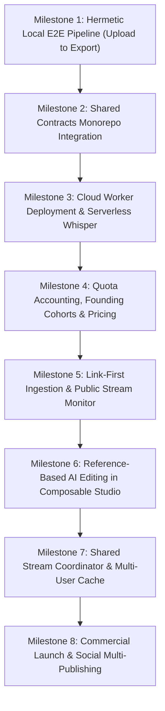

# AutoAI Edit — Step 1: Implementation Roadmap & Milestone Plan

**Document ID:** ROADMAP-STEP1-001  
**Version:** 1.0.0-PROD  
**Status:** Approved for Implementation Governance  
**Repository:** `https://github.com/RIPU05/autoedit-ai`  
**Master Commit SHA:** `f77d5ba498a43536dd0723b5eb85e169384ace34`  
**Target Branch:** `docs/step1-architecture-audit-roadmap`  

---

## 1. Roadmap Philosophy & Dependency Strategy

### 1.1 Foundation-First Invariant
Previous roadmaps assumed that background workers, transcription services, and cloud pipelines were already functional. Our empirical audit revealed that the core application pipeline cannot complete a real upload-to-export cycle even locally due to four foundational blockers (lack of local S3 endpoint override, absence of transcription fallback, missing prompt-editing fallback, and unconfigured worker deployment in `render.yaml`).

Therefore, this roadmap enforces a strict **Foundation-First Rule**:
> **The very first implementation milestone (Milestone 1) must achieve an authentic, verified local end-to-end workflow (upload → process → timeline edit → render → download) without cloud dependencies or mocks.** No new streaming or reference features will be started until the foundational pipeline is 100% verified.

---

## 2. Milestone 1: Hermetic Local E2E Pipeline (The First Executable Milestone)

### 2.1 Goal
Enable AutoAI Edit to run completely offline on a developer's machine—taking a real local MP4, uploading via S3 presigned URLs, analyzing with silence-detection fallback, editing in the web studio, rendering a vertical 9:16 reel via FFmpeg worker, and downloading the verified output—with **zero external cloud dependencies, zero external network calls, and zero cost**.

### 2.2 Existing Files Affected
- [`apps/api/src/config/env.ts`](file:///c:/Users/RIPS/Desktop/autoeditAI/autoedit-ai/apps/api/src/config/env.ts): Add `S3_ENDPOINT` and `S3_FORCE_PATH_STYLE`.
- [`apps/api/src/lib/s3.ts`](file:///c:/Users/RIPS/Desktop/autoeditAI/autoedit-ai/apps/api/src/lib/s3.ts): Support custom S3 endpoint and path-style addressing for MinIO.
- [`apps/api/src/queue/workers/analysis.worker.ts`](file:///c:/Users/RIPS/Desktop/autoeditAI/autoedit-ai/apps/api/src/queue/workers/analysis.worker.ts): Add graceful fallback when Whisper is offline.
- [`apps/api/src/services/claude.service.ts`](file:///c:/Users/RIPS/Desktop/autoeditAI/autoedit-ai/apps/api/src/services/claude.service.ts): Add rule-based deterministic fallback to `editTimelineWithPrompt`.
- [`docker-compose.yml`](file:///c:/Users/RIPS/Desktop/autoeditAI/autoedit-ai/docker-compose.yml): Add lightweight MinIO storage service with automatic bucket initialization.

### 2.3 Proposed New Files
- `apps/api/scripts/local-dev-init.ts`: One-command local storage and test user bootstrap script.
- `apps/api/tests/e2e/local-pipeline.e2e.test.ts`: Real unmocked integration test running upload → analyze → render using local services.

### 2.4 Database Changes
None. Existing Prisma schema fully supports this milestone.

### 2.5 Shared Contract Changes
None. Milestone 1 establishes the pipeline baseline before integrating the contracts package.

### 2.6 Local Dependencies
- Docker Desktop or Podman running PostgreSQL (`5432`), Redis (`6379`), and MinIO (`9000`).
- Local Node.js 20+ runtime.

### 2.7 Acceptance Criteria
1. `docker compose up -d postgres redis minio` starts clean services without port conflicts.
2. `POST /api/upload/start` returns presigned MinIO URLs when `S3_ENDPOINT` is set.
3. An uploaded MP4 is probed and analyzed successfully by `analysisWorker` even when Whisper is offline.
4. `POST /api/projects/:id/edit` executes goal presets ("go viral", "cut pauses") deterministically when Claude returns 401.
5. `renderWorker` consumes the render job, executes static FFmpeg, and uploads the 9:16 vertical reel to MinIO.
6. A Playwright script registers a test user, uploads `test_sample_10s.mp4`, triggers render, and downloads the resulting playable MP4.

### 2.8 Automated Tests
- Unit test for S3 client custom endpoint initialization.
- Regression test for `analysis.worker.ts` offline Whisper graceful degradation.
- Unit test for `claude.service.ts` deterministic prompt-edit fallback.

### 2.9 Real E2E Validation
Execute the 14-stage Playwright script against running local frontend (`localhost:3000`), local API (`localhost:4000`), and local worker, validating output MP4 stream properties with FFprobe.

### 2.10 Infrastructure Implications
Zero cloud infrastructure. 100% runs on developer machine in Docker containers.

### 2.11 Potential Breaking Changes
None. `S3_ENDPOINT` defaults to undefined, preserving existing AWS S3 production behavior.

### 2.12 Approval Gate
Human verification by repository owner (`RIPU05`) confirming successful local Playwright E2E execution report with screenshots and valid FFprobe output.

---

## 3. Milestone 2: Shared Contracts Monorepo Integration

### 3.1 Goal
Rebase and integrate `@autoedit/contracts` into master, establishing typed domain validation and eliminating duplicate interface declarations across `apps/api` and `apps/web`.

### 3.2 Affected Subsystems
- `packages/contracts`: Rebase commit `1657597` from `feature/stage2-milestone0a-shared-contracts`.
- `apps/api`: Replace ad-hoc request body parsing with `@autoedit/contracts` Zod schemas.
- `apps/web`: Import domain types directly from `@autoedit/contracts`.

### 3.3 Acceptance Criteria
- `packages/contracts` builds cleanly with declaration files generated.
- All 21 contract unit tests pass.
- API and Web builds succeed with zero type errors.

---

## 4. Milestone 3: Cloud Worker Deployment & Serverless Whisper

### 4.1 Goal
Deploy a dedicated background worker to Render to consume production BullMQ jobs, and provision serverless GPU Whisper on Modal Labs (scale-to-zero) for fast transcription.

### 4.2 Key Tasks
- Update [`render.yaml`](file:///c:/Users/RIPS/Desktop/autoeditAI/autoedit-ai/render.yaml) with background worker service definition (`startCommand: node apps/api/dist/worker.js`).
- Deploy `services/whisper/modal_app.py` to Modal Labs.
- Configure `WHISPER_URL` on Render to target the Modal endpoint.
- Verify live cloud upload and background processing without freezing in Upstash Redis.

---

## 5. Milestone 4: Quota Accounting, Founding Cohorts & Configurable Pricing

### 5.1 Goal
Implement server-side entitlement enforcement, durable clip minute accounting, and founding user cohort tracking (`SAAS-009`, `AUTH-005`) before public launch.

### 5.2 Key Tasks
- Add `WorkspaceQuota`, `UsageReservation`, `UserCohort`, and `PricingPlan` to Prisma schema.
- Implement pre-flight reservation middleware: reject processing requests if monthly allowance is exceeded.
- Build usage display widget in `apps/web/src/app/settings/page.tsx`.

---

## 6. Milestone 5: Link-First Ingestion & Public Stream Monitor

### 6.1 Goal
Enable clippers to paste public YouTube, Twitch, or Kick URLs without requiring platform OAuth logins.

### 6.2 Key Tasks
- Build link sanitizer and canonical URL resolver in `apps/api/src/adapters/media/`.
- Implement asynchronous public chat velocity monitor (EWMA spike detection) for Twitch IRC and Kick WebSocket.
- Stream media download pipeline via FFmpeg/yt-dlp with duration caps.

---

## 7. Milestone 6: Reference-Based AI Editing in Composable Studio

### 7.1 Goal
Implement exemplar-conditioned style transfer (ARCH-019, defined on unmerged branch `docs/reference-based-ai-editing`, PR #6), allowing users to upload a reference video and apply its pacing, zooms, and typography to source media.

### 7.2 Key Tasks
- Implement reference video analyzer (extract cut frequency, zoom intensity, subtitle style).
- Create reference-conditioned timeline compiler in `apps/api/src/services/reference-edit.service.ts`.
- Add Reference Video upload drawer and Style Preview component in `TimelineEditor.tsx`.

---

## 8. Milestone 7: Shared Stream Coordinator & Multi-User Ingestion Leases

### 8.1 Goal
Deploy single logical ingestion per live broadcast with circular rolling buffers, allowing multiple clippers to generate independent highlights from a shared recording.

### 8.2 Key Tasks
- Implement distributed Redis stream lease coordinator (`StreamLeaseCoordinator`).
- Deploy circular rolling buffer (30–60 min ring buffer) on fast NVMe scratch storage.
- Content-addressable highlight cache sharing analysis results across clipper projects.

---

## 9. Milestone 8: Commercial Launch & Social Multi-Publishing

### 9.1 Goal
Launch commercial self-service subscriptions via Stripe, referral reward campaigns, and direct one-click social publishing.

### 9.2 Key Tasks
- Stripe Checkout and webhook integration for monthly/annual plans.
- Referral link generation, attribution cookie tracking, and discount entitlements.
- Direct social publishing via YouTube Data API and TikTok Content Posting API.
