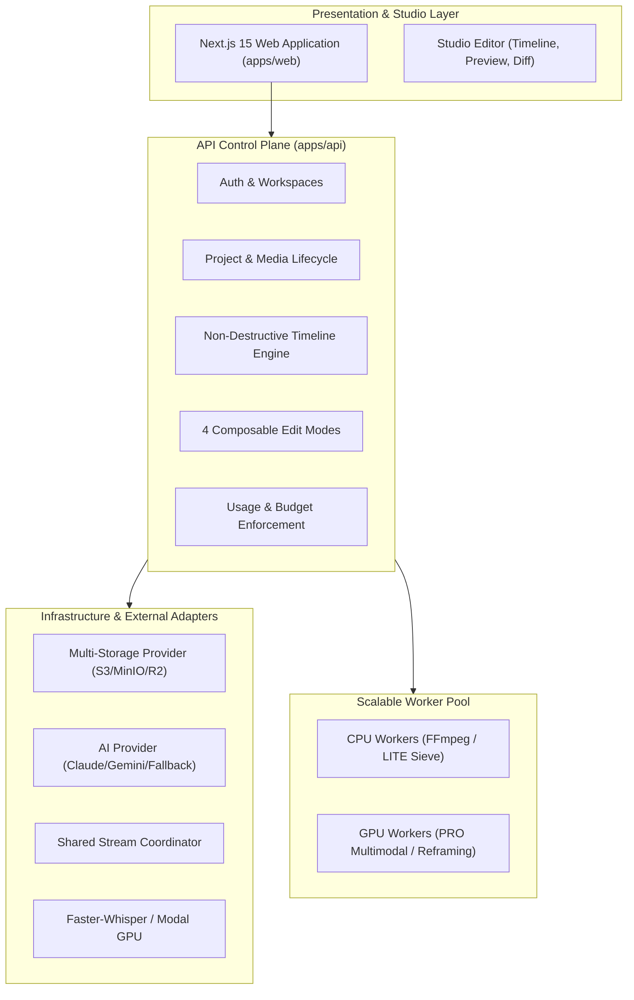

# AutoAI Edit — Step 1: Target Architecture Gap Analysis

**Document ID:** GAP-STEP1-001  
**Version:** 1.0.0-PROD  
**Status:** Approved for Implementation Governance  
**Repository:** `https://github.com/RIPU05/autoedit-ai`  
**Master Commit SHA:** `f77d5ba498a43536dd0723b5eb85e169384ace34`  
**Target Branch:** `docs/step1-architecture-audit-roadmap`  

---

## 1. Executive Summary & Architecture Strategy

This gap analysis compares the existing AutoAI Edit codebase against the target production modules required for an expandable, multi-tenant AI video platform. The overarching design principle is **modular monolith excellence**: all core domain capabilities reside within the single backend codebase (`apps/api`) and frontend (`apps/web`), sharing a database, contracts, and queues. We deliberately reject premature microservice decomposition in favor of clean internal module boundaries, strict dependency injection, and typed contracts.

---

## 2. Module-by-Module Gap Analysis

---

### Module 1: API Control Plane
- **Current State:** Express 4.21 application ([`apps/api/src/app.ts`](file:///c:/Users/RIPS/Desktop/autoeditAI/autoedit-ai/apps/api/src/app.ts)) with routes for auth, upload, projects, dashboard, n8n, health, integrations, account, analytics, feedback.
- **Target Requirements:** High-throughput async REST API, unified error envelope, standard pagination, OpenAPI/Swagger generation, idempotent command execution.
- **Gap:** Route handlers mix business logic with database access. Error responses lack standardized machine-readable error codes. No automated OpenAPI generation.
- **Recommendation:** **REFACTOR EXISTING CODE.**
- **Action:** Retain Express 4.21; refactor routes into a clean controller/service pattern with unified error middleware and standard JSON envelopes (`{ success, data, error, meta }`).

---

### Module 2: Shared Typed Contracts
- **Current State:** Monorepo package `packages/contracts/` exists exclusively on unmerged branch `feature/stage2-milestone0a-shared-contracts` (commit `1657597`). Contains 9 domain files with Zod schemas and TypeScript types.
- **Target Requirements:** Single source of truth for all domain entities, DTOs, events, and validation schemas, shared between `apps/api`, `apps/web`, and workers.
- **Gap:** Master branch lacks `packages/contracts/`. Frontend and API currently define duplicate ad-hoc types (`apps/web/src/lib/types.ts` vs `apps/api/src/types/`).
- **Recommendation:** **EXTEND EXISTING CODE (SELECTIVE INTEGRATION).**
- **Action:** Rebase and integrate `packages/contracts/` from commit `1657597` into the main development line. Wire it as a workspace dependency in `apps/api` and `apps/web`.

---

### Module 3: Identity, Workspaces & Permissions
- **Current State:** Single `User` model in [`schema.prisma`](file:///c:/Users/RIPS/Desktop/autoeditAI/autoedit-ai/apps/api/prisma/schema.prisma); `Project` directly belongs to `userId`. Roles limited to `USER` and `ADMIN`.
- **Target Requirements:** Multi-tenant workspace model where teams or clippers collaborate on shared video assets, streams, and brand kits with role-based access control (Owner, Editor, Viewer).
- **Gap:** No `Workspace` or `WorkspaceMember` models. Cannot support collaborative clipping teams or enterprise creator organizations.
- **Recommendation:** **EXTEND EXISTING CODE.**
- **Action:** Add `Workspace` and `WorkspaceMembership` models in Prisma. Default every individual user to a personal workspace to preserve 100% backward compatibility for existing single users.

---

### Module 4: Project & Media Management
- **Current State:** `Project` and `Asset` models exist. S3 key ownership verified by path prefix (`sources/<userId>/...`).
- **Target Requirements:** Comprehensive asset hierarchy: `Project`, `SourceAsset`, `ExtractedAudio`, `RenderedExport`, and `ReferenceAsset`. Deduplication of source media via SHA-256 hashes.
- **Gap:** Missing content-hash deduplication. No soft-delete lifecycle or storage retention policies.
- **Recommendation:** **EXTEND EXISTING CODE.**
- **Action:** Add `sha256` and `storageProvider` fields to `Asset`. Implement asset retention cleanup hooks.

---

### Module 5: Non-Destructive Timeline Engine
- **Current State:** `EditTimeline` and `EditVersion` models persist operations JSON (`start`, `end`, `zoom`, `keep`) and effects JSON (`subtitles`, `zooms`, `transitions`, `music`).
- **Target Requirements:** Pure functional timeline compiler that takes source metadata, an immutable operation list (`EditTimelinePlan`), and renders deterministic preview intervals or FFmpeg filter graphs.
- **Gap:** Core data model is well-designed, but operations lack strict contract validation before storage. Timeline state is stored as untyped JSON in PostgreSQL.
- **Recommendation:** **KEEP AND ENFORCE CONTRACTS.**
- **Action:** Preserve the existing `EditTimeline` and `EditVersion` tables; enforce runtime validation using `@autoedit/contracts` (`EditTimelinePlanSchema`).

---

### Module 6: Auto Edit Mode (Algorithmic Sieve)
- **Current State:** Deterministic fallback in [`apps/api/src/ai/providers.ts`](file:///c:/Users/RIPS/Desktop/autoeditAI/autoedit-ai/apps/api/src/ai/providers.ts) identifies silences and generates cut spans. Claude multimodal scoring exists but requires an active key.
- **Target Requirements:** Two-tier highlight sieve:
  - LITE: Fast CPU-based signal sieve (audio energy peaks, silence trimming, chat velocity surges).
  - PRO: Speech transcript semantic density + visual facial reaction framing.
- **Gap:** Current fallback relies strictly on silence detection without audio amplitude energy analysis or chat velocity scoring.
- **Recommendation:** **EXTEND EXISTING CODE.**
- **Action:** Enhance `buildFallbackPipelineResult` with acoustic volume envelope analysis (`ebur128` / RMS) and chat spike detection to deliver rich LITE-tier highlights at $0.00 cost.

---

### Module 7: Prompt Edit Mode (Conversational AI)
- **Current State:** Web UI has prompt input + 7 preset buttons. `POST /api/projects/:id/edit` calls `editTimelineWithPrompt` in [`claude.service.ts`](file:///c:/Users/RIPS/Desktop/autoeditAI/autoedit-ai/apps/api/src/services/claude.service.ts).
- **Target Requirements:** Natural-language conversational edit directives with robust fallback and rule-based parsing.
- **Gap:** **Single Point of Failure:** `editTimelineWithPrompt` calls Anthropic API with **no fallback**. An invalid/expired API key causes an unhandled HTTP 500 crash.
- **Recommendation:** **REFACTOR EXISTING CODE.**
- **Action:** Add a rule-based deterministic parser to `editTimelineWithPrompt` for preset goals ("go viral", "cut pauses", "make 30s") so prompt editing functions even when external AI is unavailable.

---

### Module 8: Reference-Based AI Editing Mode
- **Current State:** Completely absent from codebase. Architectural blueprint approved in `19-REFERENCE-BASED-AI-EDITING.md`.
- **Target Requirements:** Pacing and style extraction from an exemplar video (uploaded MP4 or supported public URL) applied to source footage.
- **Gap:** 100% gap in implementation (UI, API routes, database models, and style transfer logic).
- **Recommendation:** **NEW MODULE (STAGED FOR MILESTONE 6).**
- **Action:** Defer implementation until foundation infrastructure (storage, workers, and local E2E) is fully operational.

---

### Module 9: Manual Edit Mode (Timeline UI)
- **Current State:** [`TimelineEditor.tsx`](file:///c:/Users/RIPS/Desktop/autoeditAI/autoedit-ai/apps/web/src/components/TimelineEditor.tsx) provides clip trimming, reordering, keeping/removing, and effect toggling.
- **Target Requirements:** Snapping playhead, multi-track waveform display, keyframe positioning, text overlay customization.
- **Gap:** Basic list-based block editor; lacks fine-grained second/millisecond scrubbing and waveform visualization.
- **Recommendation:** **EXTEND EXISTING CODE.**
- **Action:** Maintain existing architecture; add HTML5 waveform rendering and drag-and-drop clip reordering.

---

### Module 10: Media Source Adapters (Link-First & Platforms)
- **Current State:** Web UI strictly renders `<input type="file">`. Zero URL parsing or external platform fetching logic.
- **Target Requirements:** Link-first ingestion: paste YouTube, Twitch, or Kick URL; validate permissions; extract public metadata; download authorized source media asynchronously.
- **Gap:** 100% gap in implementation.
- **Recommendation:** **NEW MODULE (MEDIA ADAPTERS).**
- **Action:** Create `apps/api/src/adapters/media/` containing platform validators, yt-dlp/ffmpeg download helpers, and rights-verification gates.

---

### Module 11: Shared Stream Coordinator & Ingestion Leases
- **Current State:** Completely absent from codebase. Blueprint approved in `06-LIVESTREAM-INGESTION-ARCHITECTURE.md`.
- **Target Requirements:** Deduplicated ingestion of live streams. When multiple clippers monitor the same live broadcast, only one stream worker records the broadcast into a shared segment buffer.
- **Gap:** 100% gap in implementation.
- **Recommendation:** **DEFER UNTIL MILESTONE 7.**
- **Action:** Build single-user recorded video workflows first; stream deduplication requires distributed locking and rolling storage buffers.

---

### Module 12: Ingestion Leases & Rolling Buffers
- **Current State:** Completely absent from codebase.
- **Target Requirements:** Circular memory/disk ring buffer holding 30–60 minutes of live stream chunks for instant clip generation.
- **Gap:** 100% gap in implementation.
- **Recommendation:** **DEFER UNTIL MILESTONE 7.**

---

### Module 13: Highlight Analysis & Shared Cache
- **Current State:** `Analysis` model in Prisma caches transcript, silences, captions, and summaries per project.
- **Target Requirements:** Content-addressable cache where identical media segments (matched by audio fingerprint or hash) share highlight calculations across users.
- **Gap:** Analysis is strictly scoped to `projectId`. No cross-project asset sharing.
- **Recommendation:** **DEFER TO MILESTONE 7.**

---

### Module 14: Storage Provider Abstraction
- **Current State:** [`apps/api/src/lib/s3.ts`](file:///c:/Users/RIPS/Desktop/autoeditAI/autoedit-ai/apps/api/src/lib/s3.ts) tightly couples the application to AWS S3.
- **Target Requirements:** Pluggable `StorageService` interface supporting AWS S3, Cloudflare R2, MinIO (local dev), and Google Cloud Storage.
- **Gap:** Hardcoded AWS client; lacks `S3_ENDPOINT` configuration in `env.ts`; blocks isolated local testing with MinIO.
- **Recommendation:** **REFACTOR EXISTING CODE (CRITICAL PREREQUISITE).**
- **Action:** Refactor `s3.ts` into a unified `StorageService` interface; add `S3_ENDPOINT` and `S3_FORCE_PATH_STYLE` support to `env.ts`.

---

### Module 15: AI Provider Abstraction
- **Current State:** [`apps/api/src/ai/providers.ts`](file:///c:/Users/RIPS/Desktop/autoeditAI/autoedit-ai/apps/api/src/ai/providers.ts) provides clean interface `AiProvider` with Claude, Ollama, and Fallback implementations.
- **Target Requirements:** Interchangeable multimodal reasoning across Claude, Gemini, OpenAI, and offline fallback, with budget tracking.
- **Gap:** Excellent foundation already implemented. Missing Google Gemini adapter and per-call token cost tracking.
- **Recommendation:** **KEEP AND EXTEND.**
- **Action:** Retain `providers.ts`; add Gemini API provider and token usage logging.

---

### Module 16: Worker Capability Registry & Scheduling
- **Current State:** Static BullMQ queues (`analysis`, `render`, `n8n-dispatch`).
- **Target Requirements:** Capability-based job routing: dispatch light CPU tasks (silence, LITE sieve, CPU transcode) to commodity CPU instances, and heavy tasks (Whisper, GPU reframing) to GPU workers.
- **Gap:** All jobs are queued generically without worker capability matching.
- **Recommendation:** **EXTEND EXISTING CODE.**
- **Action:** Add `requiredCapability` tags to BullMQ job payloads (`render-cpu` vs `render-gpu`); configure dedicated worker queues.

---

### Module 17: Usage, Quotas & Budget Enforcement
- **Current State:** Rate limiting only (`express-rate-limit`). No tracking of processed video minutes, render credits, or monthly quotas.
- **Target Requirements:** Durable quota reservation engine (`SAAS-009`, `AUTH-005`): reserve minutes before processing, deduct upon completion, hard spend caps.
- **Gap:** 100% gap in database schema and business logic.
- **Recommendation:** **NEW MODULE (QUOTA & BUDGET ENGINE).**
- **Action:** Add `UsageQuota` and `QuotaReservation` tables in Prisma; implement pre-flight reservation middleware before queuing analysis or render jobs.

---

### Module 18: Configurable Pricing, Cohorts & Referral Engine
- **Current State:** Completely absent from codebase.
- **Target Requirements:** Founding user cohorts, dynamic pricing plans (LITE vs PRO), referral code attribution, and permanent grandfathered discount entitlements.
- **Gap:** 100% gap in implementation.
- **Recommendation:** **NEW MODULE (COMMERCIAL ENGINE - MILESTONE 4/8).**
- **Action:** Implement billing models in Prisma after core media pipeline is verified end-to-end.

---

### Module 19: Notifications & Webhook Dispatch
- **Current State:** [`apps/api/src/routes/n8n.routes.ts`](file:///c:/Users/RIPS/Desktop/autoeditAI/autoedit-ai/apps/api/src/routes/n8n.routes.ts) dispatches workflow events (`render.completed`, `project.created`) to n8n.
- **Target Requirements:** Reliable webhook dispatch with HMAC signing, retries, and user-facing in-app notification toasts.
- **Gap:** n8n integration works well; user-facing in-app notifications (WebSocket/SSE) are missing.
- **Recommendation:** **KEEP EXISTING CODE; EXTEND IN-APP TOASTS.**

---

### Module 20: Observability, Metrics & Admin Operations
- **Current State:** Sentry integration, memory sampling, stage timing (`StageTiming` table), and error logging (`ErrorEvent` table) in [`apps/api/src/lib/observability.ts`](file:///c:/Users/RIPS/Desktop/autoeditAI/autoedit-ai/apps/api/src/lib/observability.ts).
- **Target Requirements:** Real-time health metrics, queue depth monitoring, worker heartbeat tracking, Prometheus/OpenTelemetry export.
- **Gap:** Strong observability foundation already in place. Lacks worker heartbeat monitoring and Prometheus metrics endpoint.
- **Recommendation:** **KEEP EXISTING CODE; ADD WORKER HEARTBEAT.**
